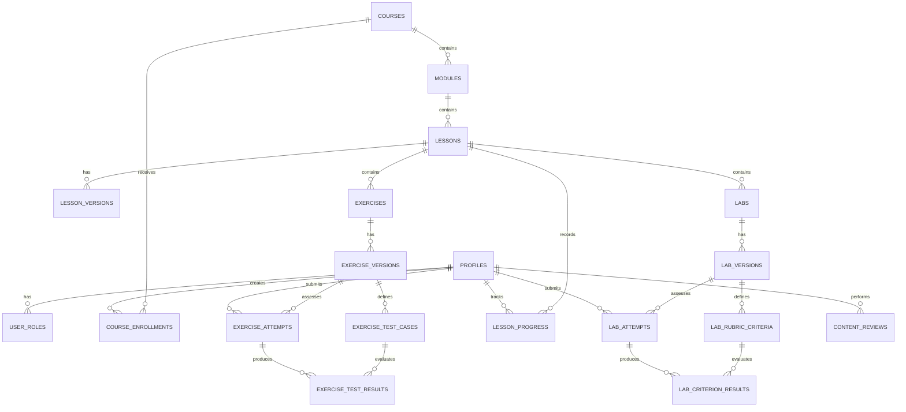

# Spascle — Data Model & Database Design Specification

**Version:** 1.1
**Scope:** MVP
**Date:** October 2026
**Status:** Proposed design

## 1. Purpose

This document defines Spascles’ database structure, relationships, integrity rules, security requirements, and migration strategy.

Spascle is an AI-powered, browser-based learning platform for scientific programming. The database must support:

- Courses, modules, lessons, exercises, and guided computational labs.
- Versioned educational content with human review and approval.
- Learner enrollment, progress, submissions, assessment results, and feedback.
- Reviewer and administrator permissions.
- Secure separation between learner-facing data and trusted assessment logic.

This document describes **what data the platform stores and how it relates**. Detailed API behavior and implementation code belong in subsequent specifications.

## 2. Design Principles

1. **Keep the architecture simple.** Use one PostgreSQL database through Supabase for the MVP.
2. **Separate authentication from application profiles.** Supabase Auth manages credentials; Prosca stores learner profile and application data.
3. **Version published content.** Attempts must reference the exact content version against which they were assessed.
4. **Protect assessment integrity.** Hidden test cases, grading configuration, and authoritative scores must remain server-side.
5. **Make results traceable.** Preserve submissions, assessment results, and feedback for later review.
6. **Use relational tables for core entities.** Use JSONB only where flexible content or configuration makes sense.
7. **Enforce access at the database and server layers.** Do not rely on frontend checks alone.
8. **Keep execution isolated.** Untrusted learner code must never execute inside the Next.js application process or receive direct database credentials.
9. **Build for the MVP, not hypothetical scale.** Add complexity only when real requirements justify it.

## 3. Technology and Naming Conventions

| Area                           | Decision                                                           |
| ------------------------------ | ------------------------------------------------------------------ |
| Database                       | PostgreSQL through Supabase                                        |
| Authentication                 | Supabase Auth                                                      |
| Primary keys                   | UUID                                                               |
| Timestamps                     | `TIMESTAMPTZ`, stored in UTC                                       |
| Flexible content/configuration | JSONB where justified                                              |
| Database changes               | Version-controlled SQL migrations                                  |
| Authorization                  | PostgreSQL Row Level Security (RLS) plus server-side authorization |
| File and dataset storage       | Supabase Storage or another approved object store, if required     |
| API                            | REST/JSON, specified separately                                    |

### Naming conventions

- Use `snake_case` for tables and columns.
- Use `id` for primary keys.
- Use descriptive foreign-key names, such as `course_id` and `user_id`.
- Use `created_at` and `updated_at` where applicable.
- Use constrained values for statuses and types.
- Store educational content in versioned records instead of overwriting published versions.

## 4. Entity Relationship Diagram

The following diagram describes the main entities and their relationships.

The diagram shows the principal relationships. Additional constraints, including version-matching rules, must be enforced in the database or trusted application services.

## 5. Core Database Tables

### 5.1 User and role management

#### `profiles`

Stores application-specific profile information.

| Column         | Type        | Rules                                   |
| -------------- | ----------- | --------------------------------------- |
| `id`           | UUID        | Primary key; references `auth.users.id` |
| `display_name` | TEXT        | Nullable                                |
| `created_at`   | TIMESTAMPTZ | Required                                |
| `updated_at`   | TIMESTAMPTZ | Required                                |

A profile is created when a user registers. Authentication credentials are not duplicated in this table.

#### `user_roles`

Stores privileged application roles.

| Column       | Type        | Rules                               |
| ------------ | ----------- | ----------------------------------- |
| `user_id`    | UUID        | Foreign key to `profiles.id`        |
| `role`       | TEXT        | Restricted to `reviewer` or `admin` |
| `created_at` | TIMESTAMPTZ | Required                            |

**Primary key:** (`user_id`, `role`)

Users without a privileged role are ordinary learners. Role assignments must be controlled by trusted server-side operations and must not be writable by learners.

### 5.2 Course structure

#### `courses`

| Column         | Type        | Rules                                                     |
| -------------- | ----------- | --------------------------------------------------------- |
| `id`           | UUID        | Primary key                                               |
| `slug`         | TEXT        | Required, unique                                          |
| `title`        | TEXT        | Required                                                  |
| `description`  | TEXT        | Required                                                  |
| `discipline`   | TEXT        | Required                                                  |
| `status`       | TEXT        | `draft`, `in_review`, `approved`, `published`, `archived` |
| `published_at` | TIMESTAMPTZ | Nullable                                                  |
| `created_at`   | TIMESTAMPTZ | Required                                                  |
| `updated_at`   | TIMESTAMPTZ | Required                                                  |

A course contains modules. Only published courses are visible in the public catalogue.

#### `modules`

| Column        | Type        | Rules                       |
| ------------- | ----------- | --------------------------- |
| `id`          | UUID        | Primary key                 |
| `course_id`   | UUID        | Foreign key to `courses.id` |
| `title`       | TEXT        | Required                    |
| `description` | TEXT        | Nullable                    |
| `position`    | INTEGER     | Required, non-negative      |
| `created_at`  | TIMESTAMPTZ | Required                    |
| `updated_at`  | TIMESTAMPTZ | Required                    |

**Unique constraint:** (`course_id`, `position`)

#### `lessons`

Represents a lesson within a module independently of its individual content versions.

| Column                         | Type        | Rules                                                      |
| ------------------------------ | ----------- | ---------------------------------------------------------- |
| `id`                           | UUID        | Primary key                                                |
| `module_id`                    | UUID        | Foreign key to `modules.id`                                |
| `title`                        | TEXT        | Required                                                   |
| `slug`                         | TEXT        | Required                                                   |
| `position`                     | INTEGER     | Required, non-negative                                     |
| `status`                       | TEXT        | Constrained publication status                             |
| `current_published_version_id` | UUID        | Nullable reference to the current published lesson version |
| `created_at`                   | TIMESTAMPTZ | Required                                                   |
| `updated_at`                   | TIMESTAMPTZ | Required                                                   |

**Unique constraints:**

- (`module_id`, `slug`)
- (`module_id`, `position`)

The foreign key for `current_published_version_id` should be added after creating `lesson_versions`, because the two tables reference one another. Ensure the selected version belongs to the same lesson.

### 5.3 Versioned educational content

Published content must be immutable. Changes should create a new version rather than modify content used by existing attempts.

#### `lesson_versions`

| Column                | Type        | Rules                                                     |
| --------------------- | ----------- | --------------------------------------------------------- |
| `id`                  | UUID        | Primary key                                               |
| `lesson_id`           | UUID        | Foreign key to `lessons.id`                               |
| `version_number`      | INTEGER     | Positive                                                  |
| `content`             | JSONB       | Required lesson content                                   |
| `learning_objectives` | JSONB       | Required array of objectives                              |
| `status`              | TEXT        | `draft`, `in_review`, `approved`, `published`, `rejected` |
| `created_by`          | UUID        | Foreign key to `profiles.id`                              |
| `created_at`          | TIMESTAMPTZ | Required                                                  |
| `published_at`        | TIMESTAMPTZ | Nullable                                                  |

**Unique constraint:** (`lesson_id`, `version_number`)

The content JSON should have a documented schema for sections, explanations, examples, and other supported lesson blocks. Validate it before publication.

#### `exercises`

Represents an exercise attached to a lesson.

| Column       | Type        | Rules                       |
| ------------ | ----------- | --------------------------- |
| `id`         | UUID        | Primary key                 |
| `lesson_id`  | UUID        | Foreign key to `lessons.id` |
| `title`      | TEXT        | Required                    |
| `position`   | INTEGER     | Required, non-negative      |
| `created_at` | TIMESTAMPTZ | Required                    |
| `updated_at` | TIMESTAMPTZ | Required                    |

**Unique constraint:** (`lesson_id`, `position`)

#### `exercise_versions`

| Column           | Type        | Rules                                  |
| ---------------- | ----------- | -------------------------------------- |
| `id`             | UUID        | Primary key                            |
| `exercise_id`    | UUID        | Foreign key to `exercises.id`          |
| `version_number` | INTEGER     | Positive                               |
| `exercise_type`  | TEXT        | `quiz` or `coding`                     |
| `instructions`   | TEXT        | Required                               |
| `starter_code`   | TEXT        | Nullable                               |
| `public_config`  | JSONB       | Learner-visible configuration          |
| `grading_config` | JSONB       | Trusted, private grading configuration |
| `status`         | TEXT        | Controlled content status              |
| `created_by`     | UUID        | Foreign key to `profiles.id`           |
| `created_at`     | TIMESTAMPTZ | Required                               |
| `published_at`   | TIMESTAMPTZ | Nullable                               |

**Unique constraint:** (`exercise_id`, `version_number`)

Public API responses must never expose `grading_config` or hidden assessment data. Keep public exercise content and private grading configuration logically separate at the API and authorization layers.

#### `exercise_test_cases`

Stores trusted test definitions for coding exercises.

| Column                | Type        | Rules                                 |
| --------------------- | ----------- | ------------------------------------- |
| `id`                  | UUID        | Primary key                           |
| `exercise_version_id` | UUID        | Foreign key to `exercise_versions.id` |
| `name`                | TEXT        | Internal test name                    |
| `test_definition`     | JSONB       | Trusted test definition               |
| `weight`              | NUMERIC     | Non-negative                          |
| `position`            | INTEGER     | Required, non-negative                |
| `created_at`          | TIMESTAMPTZ | Required                              |

**Unique constraint:** (`exercise_version_id`, `position`)

Test definitions must only be available to trusted assessment services. Do not send hidden test inputs or expected answers to the learner's browser.

#### `labs`

Represents a guided computational lab attached to a lesson.

| Column       | Type        | Rules                       |
| ------------ | ----------- | --------------------------- |
| `id`         | UUID        | Primary key                 |
| `lesson_id`  | UUID        | Foreign key to `lessons.id` |
| `title`      | TEXT        | Required                    |
| `position`   | INTEGER     | Required, non-negative      |
| `created_at` | TIMESTAMPTZ | Required                    |
| `updated_at` | TIMESTAMPTZ | Required                    |

**Unique constraint:** (`lesson_id`, `position`)

#### `lab_versions`

| Column                | Type        | Rules                             |
| --------------------- | ----------- | --------------------------------- |
| `id`                  | UUID        | Primary key                       |
| `lab_id`              | UUID        | Foreign key to `labs.id`          |
| `version_number`      | INTEGER     | Positive                          |
| `instructions`        | TEXT        | Required                          |
| `learning_objectives` | JSONB       | Required                          |
| `starter_code`        | TEXT        | Nullable                          |
| `dataset_reference`   | TEXT        | Nullable approved asset reference |
| `assessment_config`   | JSONB       | Trusted assessment configuration  |
| `status`              | TEXT        | Controlled content status         |
| `created_by`          | UUID        | Foreign key to `profiles.id`      |
| `created_at`          | TIMESTAMPTZ | Required                          |
| `published_at`        | TIMESTAMPTZ | Nullable                          |

**Unique constraint:** (`lab_id`, `version_number`)

Datasets must be approved, controlled assets. The execution environment must not fetch arbitrary URLs or user-specified resources.

#### `lab_rubric_criteria`

| Column            | Type        | Rules                            |
| ----------------- | ----------- | -------------------------------- |
| `id`              | UUID        | Primary key                      |
| `lab_version_id`  | UUID        | Foreign key to `lab_versions.id` |
| `description`     | TEXT        | Required                         |
| `assessment_type` | TEXT        | `automated` or `reviewed`        |
| `weight`          | NUMERIC     | Non-negative                     |
| `position`        | INTEGER     | Required, non-negative           |
| `created_at`      | TIMESTAMPTZ | Required                         |

**Unique constraint:** (`lab_version_id`, `position`)

Automated criteria can be evaluated using trusted tests or deterministic rules. Human-reviewed criteria may be used where an objective automated score is not yet reliable.

### 5.4 Learner enrollment and progress

#### `course_enrollments`

| Column         | Type        | Rules                        |
| -------------- | ----------- | ---------------------------- |
| `id`           | UUID        | Primary key                  |
| `user_id`      | UUID        | Foreign key to `profiles.id` |
| `course_id`    | UUID        | Foreign key to `courses.id`  |
| `status`       | TEXT        | `active` or `completed`      |
| `started_at`   | TIMESTAMPTZ | Required                     |
| `completed_at` | TIMESTAMPTZ | Nullable                     |

**Unique constraint:** (`user_id`, `course_id`)

Create an enrollment when a learner starts a course. Browsing public course information does not require enrollment.

#### `lesson_progress`

| Column           | Type        | Rules                                     |
| ---------------- | ----------- | ----------------------------------------- |
| `id`             | UUID        | Primary key                               |
| `user_id`        | UUID        | Foreign key to `profiles.id`              |
| `lesson_id`      | UUID        | Foreign key to `lessons.id`               |
| `status`         | TEXT        | `not_started`, `in_progress`, `completed` |
| `last_viewed_at` | TIMESTAMPTZ | Nullable                                  |
| `completed_at`   | TIMESTAMPTZ | Nullable                                  |
| `updated_at`     | TIMESTAMPTZ | Required                                  |

**Unique constraint:** (`user_id`, `lesson_id`)

Progress is a summary of the learner's current state. Detailed submissions and scores remain in attempt tables.

### 5.5 Exercise attempts and results

#### `exercise_attempts`

| Column                | Type        | Rules                                                                   |
| --------------------- | ----------- | ----------------------------------------------------------------------- |
| `id`                  | UUID        | Primary key                                                             |
| `user_id`             | UUID        | Foreign key to `profiles.id`                                            |
| `exercise_version_id` | UUID        | Foreign key to `exercise_versions.id`                                   |
| `attempt_number`      | INTEGER     | Positive                                                                |
| `submission`          | JSONB       | Required submitted answers or code                                      |
| `status`              | TEXT        | `submitted`, `running`, `graded`, `failed`, `system_error`, `cancelled` |
| `score`               | NUMERIC     | Nullable until graded                                                   |
| `max_score`           | NUMERIC     | Positive                                                                |
| `feedback`            | JSONB       | Nullable learner-facing feedback                                        |
| `submitted_at`        | TIMESTAMPTZ | Required                                                                |
| `graded_at`           | TIMESTAMPTZ | Nullable                                                                |

**Unique constraint:** (`user_id`, `exercise_version_id`, `attempt_number`)

`system_error` and `cancelled` distinguish infrastructure problems from incorrect answers. System failures must not be treated as ordinary failed submissions or unfairly penalize learners.

#### `exercise_test_results`

| Column          | Type        | Rules                                   |
| --------------- | ----------- | --------------------------------------- |
| `id`            | UUID        | Primary key                             |
| `attempt_id`    | UUID        | Foreign key to `exercise_attempts.id`   |
| `test_case_id`  | UUID        | Foreign key to `exercise_test_cases.id` |
| `status`        | TEXT        | `passed`, `failed`, `error`, `skipped`  |
| `score_awarded` | NUMERIC     | Non-negative                            |
| `message`       | TEXT        | Safe learner-facing message             |
| `created_at`    | TIMESTAMPTZ | Required                                |

**Unique constraint:** (`attempt_id`, `test_case_id`)

The trusted grader must verify that each test case belongs to the exact exercise version associated with the attempt. This can be enforced with composite foreign keys or equivalent database constraints and trusted validation.

### 5.6 Lab attempts and results

#### `lab_attempts`

| Column           | Type        | Rules                                                                   |
| ---------------- | ----------- | ----------------------------------------------------------------------- |
| `id`             | UUID        | Primary key                                                             |
| `user_id`        | UUID        | Foreign key to `profiles.id`                                            |
| `lab_version_id` | UUID        | Foreign key to `lab_versions.id`                                        |
| `attempt_number` | INTEGER     | Positive                                                                |
| `submission`     | JSONB       | Required submitted work or outputs                                      |
| `status`         | TEXT        | `submitted`, `running`, `graded`, `failed`, `system_error`, `cancelled` |
| `score`          | NUMERIC     | Nullable until graded                                                   |
| `max_score`      | NUMERIC     | Positive                                                                |
| `feedback`       | JSONB       | Nullable learner-facing feedback                                        |
| `submitted_at`   | TIMESTAMPTZ | Required                                                                |
| `graded_at`      | TIMESTAMPTZ | Nullable                                                                |

**Unique constraint:** (`user_id`, `lab_version_id`, `attempt_number`)

#### `lab_criterion_results`

| Column                | Type        | Rules                                     |
| --------------------- | ----------- | ----------------------------------------- |
| `id`                  | UUID        | Primary key                               |
| `lab_attempt_id`      | UUID        | Foreign key to `lab_attempts.id`          |
| `rubric_criterion_id` | UUID        | Foreign key to `lab_rubric_criteria.id`   |
| `status`              | TEXT        | `met`, `not_met`, `needs_review`, `error` |
| `score_awarded`       | NUMERIC     | Non-negative                              |
| `feedback`            | TEXT        | Nullable                                  |
| `created_at`          | TIMESTAMPTZ | Required                                  |

**Unique constraint:** (`lab_attempt_id`, `rubric_criterion_id`)

The assessment service must verify that each criterion belongs to the exact lab version associated with the attempt.

### 5.7 Content review workflow

#### `content_reviews`

| Column         | Type        | Rules                                                         |
| -------------- | ----------- | ------------------------------------------------------------- |
| `id`           | UUID        | Primary key                                                   |
| `reviewer_id`  | UUID        | Foreign key to `profiles.id`                                  |
| `content_type` | TEXT        | `course`, `lesson_version`, `exercise_version`, `lab_version` |
| `content_id`   | UUID        | ID of the reviewed content record                             |
| `decision`     | TEXT        | `approved`, `rejected`, `changes_requested`                   |
| `comments`     | TEXT        | Nullable                                                      |
| `created_at`   | TIMESTAMPTZ | Required                                                      |

The `content_id` field is polymorphic and cannot directly reference several different tables with a single ordinary foreign key. For the MVP, the application must validate that the target exists and matches `content_type`. If stronger database-level referential integrity becomes necessary, replace this pattern with separate review tables or a normalized review-target structure.

Every review action must verify reviewer permissions and the content's current state. Publication must only occur after the required approval checks pass.

## 6. Relationships and Cardinality

| Relationship                   | Cardinality |
| ------------------------------ | ----------- |
| Course → Modules               | One-to-many |
| Module → Lessons               | One-to-many |
| Lesson → Lesson versions       | One-to-many |
| Lesson → Exercises             | One-to-many |
| Exercise → Exercise versions   | One-to-many |
| Exercise version → Test cases  | One-to-many |
| Lesson → Labs                  | One-to-many |
| Lab → Lab versions             | One-to-many |
| Lab version → Rubric criteria  | One-to-many |
| User → Enrollments             | One-to-many |
| User → Lesson progress records | One-to-many |
| User → Exercise attempts       | One-to-many |
| User → Lab attempts            | One-to-many |
| Attempt → Assessment results   | One-to-many |
| Reviewer → Content reviews     | One-to-many |

## 7. Data Integrity Rules

The following rules should be enforced through database constraints wherever possible, with additional trusted server-side validation where necessary.

1. Primary keys must be unique and non-null.
2. Foreign keys must reference existing records.
3. Ordering positions must be non-negative and unique within their parent.
4. Version numbers must be positive and unique within their parent content item.
5. Published content versions must not be edited in place.
6. Every attempt must reference the exact published exercise or lab version being assessed.
7. Test results and rubric results must reference criteria belonging to the attempt's version.
8. Attempt numbers must be positive and unique for the relevant learner and version.
9. Scores must be non-negative and no greater than `max_score`; `max_score` must be positive.
10. Learners must not be able to edit authoritative scores, assessment results, roles, or review decisions.
11. Infrastructure failures must be distinguishable from incorrect answers.
12. User deletion must not accidentally cascade into shared course content or destroy required aggregate records.
13. Publication must verify that all required content, assessment definitions, and approved assets exist.
14. Operations that change publication state or create a new authoritative score should be transactional where appropriate.

Where a rule cannot be represented cleanly as a `CHECK`, `UNIQUE`, or foreign-key constraint, enforce it through a trusted service or database function.

## 8. Indexing Strategy

Create indexes for frequent lookups and constraints, rather than indexing every field preemptively.

Recommended indexes include:

- Unique index on `courses.slug`.
- Index on `courses(status, discipline)`.
- Unique index on `modules(course_id, position)`.
- Unique index on `lessons(module_id, position)`.
- Unique indexes on each version table's parent ID and `version_number`.
- Index on `course_enrollments(user_id, status)`.
- Unique index on `lesson_progress(user_id, lesson_id)`.
- Index on `exercise_attempts(user_id, submitted_at DESC)`.
- Index on `lab_attempts(user_id, submitted_at DESC)`.
- Index on `content_reviews(content_type, content_id, created_at DESC)`.
- Index on `content_reviews(reviewer_id, created_at DESC)`.

PostgreSQL does not automatically index every foreign-key column. Add indexes to referencing columns when needed for joins, deletion checks, or common queries.

Do not introduce table partitioning, extensive JSONB indexing, or materialized analytics views until measured usage demonstrates a need.

## 9. Security and Row Level Security

Enable Row Level Security (RLS) on tables exposed through Supabase's client-accessible APIs.

| Data                                   | Learner access                        | Reviewer access                       | Administrator access       |
| -------------------------------------- | ------------------------------------- | ------------------------------------- | -------------------------- |
| Published courses and content          | Read                                  | Read                                  | Read                       |
| Draft and review content               | No                                    | Authorized review access              | Authorized management      |
| Own profile                            | Read/update permitted fields          | Same                                  | Controlled support access  |
| Own progress and enrollments           | Read/write permitted fields           | As authorized                         | Controlled support access  |
| Own attempts and feedback              | Read; submit through trusted workflow | Read only if authorized               | Controlled support access  |
| Other learners' private records        | No                                    | No by default                         | Restricted, audited access |
| Hidden tests and grading configuration | No                                    | Authorized content-review access only | Authorized management      |
| Roles and review decisions             | No                                    | Authorized review actions             | Authorized role management |

### Required controls

- Use `auth.uid()` to restrict learner-owned records to the authenticated user.
- Verify privileged roles on the server and within relevant database policies.
- Do not let users assign themselves reviewer or administrator roles.
- Keep the Supabase service-role key and other secrets exclusively on trusted servers.
- Do not expose hidden test cases or private grading configuration through client queries.
- Perform authoritative grading in a trusted service, not in browser code.
- Prefer preventing the isolated code-execution service from accessing the database directly.
- Validate course, version, enrollment, and ownership rules before accepting submissions.
- Ensure AI-generated feedback cannot independently change authoritative scores.
- Review and test RLS policies before production deployment.

## 10. Database Migration Strategy

Use version-controlled SQL migrations. Suggested initial migration sequence:

1. `001_profiles_and_roles`
2. `002_learning_structure`
3. `003_content_versioning`
4. `004_assessment_definitions`
5. `005_learner_activity`
6. `006_assessment_results`
7. `007_content_reviews`
8. `008_indexes_and_rls`

### Migration rules

- Never modify a migration that has already been applied to a shared or production environment; create a new migration instead.
- Test migrations against a non-production database first.
- Keep seed content and development fixtures separate from schema migrations.
- Test RLS policies using learner, reviewer, and administrator accounts.
- Use an expand-and-contract approach for potentially breaking schema changes.
- Back up relevant data before risky migrations.
- Ensure a fresh environment can be recreated from the migration history.

## 11. Backup and Recovery

- Confirm the backup and point-in-time recovery capabilities of the selected Supabase plan.
- Define acceptable recovery point and recovery time objectives before launch.
- Keep migrations and essential configuration in version control.
- Back up educational content and other critical data according to the selected plan and operational requirements.
- Restrict access to backups because they may contain private learner data.
- Periodically test restoring a backup into a separate environment.

A backup is only useful if the restoration process has been tested.

## 12. Important Design Decisions

### Why version content?

Learners may submit attempts against older published content. Versioning preserves the original instructions and assessment definitions so historical scores remain interpretable.

### Why separate progress from attempts?

Progress provides a quick summary for dashboards. Attempt records preserve the detailed history of submissions, scores, and feedback.

### Why keep hidden tests separate?

Private test cases and grading configuration must remain inaccessible to learners. Separating them makes access control easier to reason about and audit.

### Why use JSONB selectively?

Lesson blocks, submissions, and some configuration are naturally flexible. Core relationships, ownership, versions, statuses, and assessment results remain relational for stronger integrity.

### Why use one database?

A single PostgreSQL database reduces operational overhead for the MVP. Separate databases or more complex service boundaries should be considered only when a demonstrated requirement justifies them.

### Why isolate code execution?

Learner-submitted code is untrusted. A separate disposable execution service provides a security boundary between code execution and the application, database, and secrets.

## 13. Implementation Acceptance Checklist

Before considering the database foundation ready:

- [ ] All tables and relationships are implemented through migrations.
- [ ] Foreign keys, unique constraints, status checks, and score constraints are tested.
- [ ] Published content versions cannot be edited in place.
- [ ] Attempts reference the exact content version assessed.
- [ ] Cross-version test and rubric references are rejected.
- [ ] RLS is enabled and tested for all exposed tables.
- [ ] Learners cannot access other learners' private records.
- [ ] Hidden grading data is unavailable through public APIs.
- [ ] Role assignments and review decisions require trusted authorization.
- [ ] System execution errors do not count as ordinary failed answers.
- [ ] Database migrations can recreate a fresh environment.
- [ ] Backup and restoration procedures are documented and tested.points, request and response schemas, authentication requirements, error formats, submission lifecycle, and revieer actions that connect the Next.js frontend, database, AI service, and isolated code-execution service.

