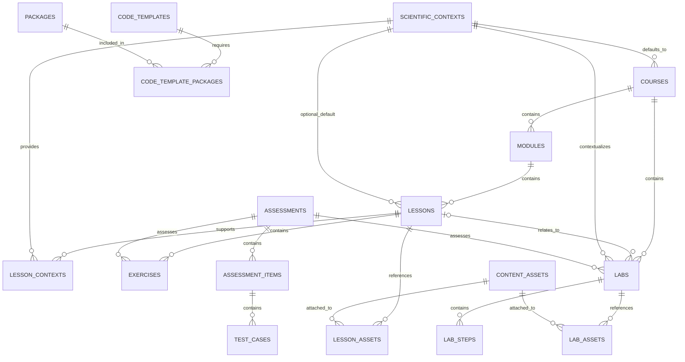

# SPASCLE — Data Models and Database Design

**Version:** 1.0  
**Scope:** MVP / Release 1  
**Date:** November 2026  
**Status:** Draft

---

# 1. Purpose

This document defines the data models and relational database design for the SPASCLE MVP.

It establishes:

- The information the platform needs to store.
- The entities and their attributes.
- Relationships between entities.
- The structure of the PostgreSQL database.
- Primary keys, foreign keys, and data constraints.
- How educational content, scientific contexts, exercises, assessments, and guided labs are represented.
- Data integrity and lifecycle requirements.
- Provisions for future database extensions.

The database design supports a public, browser-based learning platform focused initially on Python for computational materials science.

# 2. Database Design Scope

## 2.1 Included in the MVP

The database must support:

1. Courses and course organization.
2. Modules and lessons.
3. Structured lesson content.
4. Scientific contexts and context-specific lesson variations.
5. Coding and conceptual exercises.
6. Assessments and assessment questions.
7. Guided computational labs.
8. Lab steps and associated learning resources.
9. Code templates and starter code.
10. Approved programming packages.
11. Learning resources and content assets.
12. Internal content drafts and publication status.

## 2.2 Excluded from the MVP

The following database functionality belongs to future releases:

- Learner registration and authentication.
- User profiles.
- Persistent learner progress.
- Course enrollment records.
- Persistent assessment history.
- Course completion percentages.
- Administrator accounts and permissions.
- Reviewer accounts and permissions.
- Formal content-review assignments.
- Payment and subscription records.
- Classroom and institutional records.

The MVP must not introduce unnecessary user or account tables simply to accommodate functionality that has not yet been approved.

## 2.3 Database Technology

**Recommended database: PostgreSQL**

PostgreSQL is suitable because the platform requires:

- Relational data integrity.
- Structured relationships between learning entities.
- JSONB support for flexible lesson content.
- Constraints and indexes.
- Support for future database extensions.

Use relational tables for entities with predictable structures and relationships. Use JSONB for content structures that require flexibility, such as lesson blocks, learning objectives, grading criteria, and metadata.

JSONB should not replace relational tables when the information requires independent querying, relationships, or integrity constraints.

# 3. Data Modelling Principles

The database design follows these principles:

### 3.1 Normalization

Avoid unnecessary duplication of data. Each entity should have a clearly defined responsibility.

### 3.2 Referential integrity

Use primary keys and foreign keys to maintain valid relationships between records.

### 3.3 Reusable content

Lessons, exercises, assessments, code templates, and learning resources should be reusable where appropriate.

### 3.4 Context flexibility

Scientific contexts should be represented independently from lessons so that lessons can support multiple scientific fields without duplicating the entire lesson structure.

### 3.5 Structured educational content

Lesson content should consist of structured content blocks rather than a single large text field.

### 3.6 Future extensibility

The schema should allow future authentication, learner progress, and content-review functionality without requiring fundamental changes to the core learning entities.

# 4. Entity Overview

The MVP database contains the following principal entities.

| Entity | Description |
|---|---|
| Course | Represents a complete learning course. |
| Module | Groups related lessons within a course. |
| Lesson | Represents an individual learning unit. |
| ScientificContext | Defines a scientific field or context. |
| LessonContext | Connects lessons to context-specific content. |
| Exercise | Represents a coding or conceptual activity. |
| Assessment | Defines an assessment and its grading configuration. |
| AssessmentItem | Represents an individual assessment question or task. |
| TestCase | Defines automated test cases for coding assessments. |
| Lab | Represents a guided computational learning activity. |
| LabStep | Defines an individual step within a lab. |
| CodeTemplate | Stores reusable starter code and reference code. |
| Package | Defines approved programming packages. |
| ContentAsset | Stores references to educational resources. |
| ContentDraft | Stores unpublished content drafts. |

# 5. Entity Definitions

## 5.1 Course

Represents a complete learning programme.

**Table:** `courses`

| Attribute | Data Type | Constraints | Description |
|---|---|---|---|
| id | UUID | PK | Unique course identifier. |
| title | VARCHAR(200) | NOT NULL | Course title. |
| slug | VARCHAR(200) | UNIQUE, NOT NULL | URL-friendly identifier. |
| description | TEXT | NULL | Course description. |
| subject_area | VARCHAR(100) | NOT NULL | Main subject area. |
| programming_language | VARCHAR(50) | NOT NULL | Primary programming language. |
| default_context_id | UUID | FK, NOT NULL | Default scientific context. |
| difficulty_level | VARCHAR(30) | NOT NULL | Beginner, intermediate, or advanced. |
| learning_objectives | JSONB | NOT NULL | Course-level learning objectives. |
| thumbnail_asset_id | UUID | FK, NULL | Optional course thumbnail. |
| status | VARCHAR(20) | NOT NULL | Draft, published, or archived. |
| display_order | INTEGER | NOT NULL | Course display position. |
| created_at | TIMESTAMPTZ | NOT NULL | Creation timestamp. |
| updated_at | TIMESTAMPTZ | NOT NULL | Last modification timestamp. |

**Example:**

- Title: Python for Computational Materials Science
- Subject area: Materials Science
- Programming language: Python
- Default context: Materials Science
- Difficulty: Beginner

A course has one default scientific context but may contain lessons supporting other contexts.

## 5.2 Module

Groups related lessons within a course.

**Table:** `modules`

| Attribute | Data Type | Constraints | Description |
|---|---|---|---|
| id | UUID | PK | Unique module identifier. |
| course_id | UUID | FK, NOT NULL | Parent course. |
| title | VARCHAR(200) | NOT NULL | Module title. |
| slug | VARCHAR(200) | NOT NULL | URL-friendly identifier. |
| description | TEXT | NULL | Module description. |
| learning_objectives | JSONB | NOT NULL | Module learning objectives. |
| display_order | INTEGER | NOT NULL | Position within course. |
| status | VARCHAR(20) | NOT NULL | Draft, published, or archived. |
| created_at | TIMESTAMPTZ | NOT NULL | Creation timestamp. |
| updated_at | TIMESTAMPTZ | NOT NULL | Last modification timestamp. |

The combination of `course_id` and `slug` must be unique.

## 5.3 Lesson

Represents an individual learning unit.

**Table:** `lessons`

| Attribute | Data Type | Constraints | Description |
|---|---|---|---|
| id | UUID | PK | Unique lesson identifier. |
| module_id | UUID | FK, NOT NULL | Parent module. |
| title | VARCHAR(200) | NOT NULL | Lesson title. |
| slug | VARCHAR(200) | NOT NULL | URL-friendly identifier. |
| description | TEXT | NULL | Short lesson description. |
| content | JSONB | NOT NULL | Structured lesson content. |
| learning_objectives | JSONB | NOT NULL | Lesson objectives. |
| estimated_duration | INTEGER | NULL | Estimated duration in minutes. |
| lesson_type | VARCHAR(30) | NOT NULL | Concept, tutorial, exercise, or lab. |
| default_context_id | UUID | FK, NULL | Optional lesson-specific default context. |
| display_order | INTEGER | NOT NULL | Position within module. |
| status | VARCHAR(20) | NOT NULL | Draft, published, or archived. |
| created_at | TIMESTAMPTZ | NOT NULL | Creation timestamp. |
| updated_at | TIMESTAMPTZ | NOT NULL | Last modification timestamp. |

The combination of `module_id` and `slug` must be unique.

### Lesson content structure

The `content` field should contain structured JSONB blocks.

Example:

```json
{
  "blocks": [
    {
      "id": "block-001",
      "type": "heading",
      "content": "Introduction to Python Variables"
    },
    {
      "id": "block-002",
      "type": "paragraph",
      "content": "Variables store values that can be used later in a program."
    },
    {
      "id": "block-003",
      "type": "code",
      "language": "python",
      "content": "temperature = 300"
    },
    {
      "id": "block-004",
      "type": "explanation",
      "content": "The variable temperature stores the value 300."
    },
    {
      "id": "block-005",
      "type": "exercise",
      "exercise_id": "00000000-0000-0000-0000-000000000001"
    }
  ]
}
```

Suggested block types:

- heading
- paragraph
- code
- explanation
- image
- video
- callout
- formula
- table
- exercise
- quiz
- dataset
- interactive_example

The content structure should be versioned or validated against an agreed schema so that changes to the frontend do not silently invalidate existing lessons.

## 5.4 ScientificContext

Defines the scientific contexts available across the platform.

**Table:** `scientific_contexts`

| Attribute | Data Type | Constraints | Description |
|---|---|---|---|
| id | UUID | PK | Unique context identifier. |
| name | VARCHAR(100) | UNIQUE, NOT NULL | Context name. |
| slug | VARCHAR(100) | UNIQUE, NOT NULL | URL-friendly identifier. |
| description | TEXT | NULL | Context description. |
| icon | VARCHAR(100) | NULL | Icon reference. |
| is_active | BOOLEAN | NOT NULL, DEFAULT TRUE | Availability status. |
| display_order | INTEGER | NOT NULL | Display position. |
| created_at | TIMESTAMPTZ | NOT NULL | Creation timestamp. |

Initial contexts:

- Materials Science
- Chemistry
- Physics
- Biology
- Biochemistry
- General Programming

The database should allow additional contexts to be added without altering the course or lesson schema.

## 5.5 LessonContext

Connects a lesson to an available scientific context and stores the context-specific content.

**Table:** `lesson_contexts`

| Attribute | Data Type | Constraints | Description |
|---|---|---|---|
| id | UUID | PK | Unique record identifier. |
| lesson_id | UUID | FK, NOT NULL | Associated lesson. |
| context_id | UUID | FK, NOT NULL | Associated scientific context. |
| content | JSONB | NOT NULL | Context-specific lesson content. |
| status | VARCHAR(20) | NOT NULL | Draft, published, or unavailable. |
| created_at | TIMESTAMPTZ | NOT NULL | Creation timestamp. |
| updated_at | TIMESTAMPTZ | NOT NULL | Last modification timestamp. |

The combination of `lesson_id` and `context_id` must be unique.

**Important modelling decision:**

The lesson's default content is stored in `lessons.content`. Alternative context-specific versions are stored in `lesson_contexts.content`.

For example, a lesson about Python lists may use:

- Materials science: atomic numbers.
- Chemistry: molecular masses.
- Physics: measured temperatures.
- General programming: lists of names.

This avoids duplicating the entire lesson for every scientific context.

If a context-specific version is unavailable, the application can fall back to the lesson's default content.

## 5.6 Exercise

Represents an individual coding or conceptual activity.

**Table:** `exercises`

| Attribute | Data Type | Constraints | Description |
|---|---|---|---|
| id | UUID | PK | Unique exercise identifier. |
| lesson_id | UUID | FK, NOT NULL | Parent lesson. |
| title | VARCHAR(200) | NOT NULL | Exercise title. |
| description | TEXT | NOT NULL | Exercise instructions. |
| exercise_type | VARCHAR(30) | NOT NULL | Coding, multiple choice, short answer, or conceptual. |
| difficulty | VARCHAR(20) | NOT NULL | Easy, medium, or hard. |
| starter_code_id | UUID | FK, NULL | Associated starter code. |
| assessment_id | UUID | FK, NULL | Associated assessment. |
| context_id | UUID | FK, NULL | Optional scientific context. |
| hints | JSONB | NOT NULL | Available hints. |
| display_order | INTEGER | NOT NULL | Position within lesson. |
| status | VARCHAR(20) | NOT NULL | Draft, published, or archived. |
| created_at | TIMESTAMPTZ | NOT NULL | Creation timestamp. |
| updated_at | TIMESTAMPTZ | NOT NULL | Last modification timestamp. |

Exercises belong to lessons in the MVP. If reusable exercises are needed across multiple lessons later, a separate many-to-many association table can be introduced.

## 5.7 Assessment

Defines the grading configuration for an exercise, quiz, or lab.

**Table:** `assessments`

| Attribute | Data Type | Constraints | Description |
|---|---|---|---|
| id | UUID | PK | Unique assessment identifier. |
| title | VARCHAR(200) | NOT NULL | Assessment title. |
| description | TEXT | NULL | Assessment description. |
| assessment_type | VARCHAR(30) | NOT NULL | Coding, quiz, lab, or mixed. |
| passing_score | NUMERIC(6,2) | NULL | Minimum passing score. |
| total_points | NUMERIC(8,2) | NOT NULL | Maximum available points. |
| grading_method | VARCHAR(30) | NOT NULL | Automated, rubric, or hybrid. |
| settings | JSONB | NOT NULL | Additional assessment configuration. |
| status | VARCHAR(20) | NOT NULL | Draft, published, or archived. |
| created_at | TIMESTAMPTZ | NOT NULL | Creation timestamp. |
| updated_at | TIMESTAMPTZ | NOT NULL | Last modification timestamp. |

Assessment records are independent so that grading configuration is not embedded directly inside lesson content.

## 5.8 AssessmentItem

Represents an individual question or task within an assessment.

**Table:** `assessment_items`

| Attribute | Data Type | Constraints | Description |
|---|---|---|---|
| id | UUID | PK | Unique item identifier. |
| assessment_id | UUID | FK, NOT NULL | Parent assessment. |
| item_type | VARCHAR(30) | NOT NULL | Multiple choice, short answer, code task, or test-based task. |
| prompt | TEXT | NOT NULL | Question or task instructions. |
| options | JSONB | NULL | Answer options, where applicable. |
| expected_answer | JSONB | NULL | Expected answer or reference. |
| grading_criteria | JSONB | NOT NULL | Marking rules. |
| points | NUMERIC(6,2) | NOT NULL | Points allocated. |
| display_order | INTEGER | NOT NULL | Position within assessment. |
| created_at | TIMESTAMPTZ | NOT NULL | Creation timestamp. |
| updated_at | TIMESTAMPTZ | NOT NULL | Last modification timestamp. |

## 5.9 TestCase

Defines individual test cases for coding assessments.

**Table:** `test_cases`

| Attribute | Data Type | Constraints | Description |
|---|---|---|---|
| id | UUID | PK | Unique test case identifier. |
| assessment_item_id | UUID | FK, NOT NULL | Associated assessment item. |
| input_data | JSONB | NULL | Input supplied to the submitted code. |
| expected_output | JSONB | NOT NULL | Expected result. |
| comparison_method | VARCHAR(30) | NOT NULL | Exact, numeric tolerance, or custom comparison. |
| tolerance | NUMERIC(12,8) | NULL | Optional numeric tolerance. |
| points | NUMERIC(6,2) | NOT NULL | Points allocated. |
| is_hidden | BOOLEAN | NOT NULL, DEFAULT FALSE | Whether test details are hidden from learners. |
| display_order | INTEGER | NOT NULL | Test sequence. |

Test cases should be stored separately from assessment prompts to support multiple tests per coding task.

Hidden test cases must not be exposed through publicly accessible assessment content.

## 5.10 Lab

Represents a guided computational learning activity.

**Table:** `labs`

| Attribute | Data Type | Constraints | Description |
|---|---|---|---|
| id | UUID | PK | Unique lab identifier. |
| course_id | UUID | FK, NOT NULL | Parent course. |
| lesson_id | UUID | FK, NULL | Optional related lesson. |
| title | VARCHAR(200) | NOT NULL | Lab title. |
| slug | VARCHAR(200) | NOT NULL | URL-friendly identifier. |
| description | TEXT | NOT NULL | Lab overview. |
| scientific_context_id | UUID | FK, NOT NULL | Scientific context. |
| learning_objectives | JSONB | NOT NULL | Lab objectives. |
| difficulty | VARCHAR(20) | NOT NULL | Beginner, intermediate, or advanced. |
| estimated_duration | INTEGER | NULL | Estimated duration in minutes. |
| assessment_id | UUID | FK, NULL | Associated assessment. |
| status | VARCHAR(20) | NOT NULL | Draft, published, or archived. |
| created_at | TIMESTAMPTZ | NOT NULL | Creation timestamp. |
| updated_at | TIMESTAMPTZ | NOT NULL | Last modification timestamp. |

A lab can be associated with a lesson or accessed independently.

## 5.11 LabStep

Defines the individual steps within a guided lab.

**Table:** `lab_steps`

| Attribute | Data Type | Constraints | Description |
|---|---|---|---|
| id | UUID | PK | Unique step identifier. |
| lab_id | UUID | FK, NOT NULL | Parent lab. |
| title | VARCHAR(200) | NOT NULL | Step title. |
| instructions | TEXT | NOT NULL | Step instructions. |
| content | JSONB | NOT NULL | Structured explanatory content. |
| starter_code_id | UUID | FK, NULL | Associated code template. |
| assessment_item_id | UUID | FK, NULL | Associated assessment task. |
| display_order | INTEGER | NOT NULL | Step sequence. |
| created_at | TIMESTAMPTZ | NOT NULL | Creation timestamp. |
| updated_at | TIMESTAMPTZ | NOT NULL | Last modification timestamp. |

The combination of `lab_id` and `display_order` must be unique.

## 5.12 CodeTemplate

Stores reusable code examples, starter code, and reference code.

**Table:** `code_templates`

| Attribute | Data Type | Constraints | Description |
|---|---|---|---|
| id | UUID | PK | Unique template identifier. |
| title | VARCHAR(200) | NOT NULL | Template title. |
| description | TEXT | NULL | Template purpose. |
| language | VARCHAR(50) | NOT NULL | Programming language. |
| code | TEXT | NOT NULL | Code content. |
| expected_output | JSONB | NULL | Expected output, where applicable. |
| is_starter_template | BOOLEAN | NOT NULL, DEFAULT TRUE | Indicates starter or reference code. |
| created_at | TIMESTAMPTZ | NOT NULL | Creation timestamp. |
| updated_at | TIMESTAMPTZ | NOT NULL | Last modification timestamp. |

Package requirements should be represented through a separate association table.

## 5.13 Package

Defines programming packages supported by the learning environment.

**Table:** `packages`

| Attribute | Data Type | Constraints | Description |
|---|---|---|---|
| id | UUID | PK | Unique package identifier. |
| name | VARCHAR(100) | NOT NULL | Package name. |
| version | VARCHAR(50) | NOT NULL | Approved version. |
| description | TEXT | NULL | Package description. |
| is_enabled | BOOLEAN | NOT NULL, DEFAULT TRUE | Availability status. |
| created_at | TIMESTAMPTZ | NOT NULL | Creation timestamp. |

The combination of `name` and `version` must be unique.

## 5.14 CodeTemplatePackage

Connects code templates to their required packages.

**Table:** `code_template_packages`

| Attribute | Data Type | Constraints | Description |
|---|---|---|---|
| code_template_id | UUID | PK, FK | Associated code template. |
| package_id | UUID | PK, FK | Required package. |

This is a many-to-many relationship.

A code template can require multiple packages, and a package can be used by multiple templates.

## 5.15 ContentAsset

Stores references to educational resources.

**Table:** `content_assets`

| Attribute | Data Type | Constraints | Description |
|---|---|---|---|
| id | UUID | PK | Unique asset identifier. |
| title | VARCHAR(200) | NOT NULL | Asset title. |
| asset_type | VARCHAR(30) | NOT NULL | Image, dataset, document, diagram, or file. |
| storage_key | TEXT | NOT NULL | Object storage reference. |
| file_format | VARCHAR(50) | NULL | File format. |
| description | TEXT | NULL | Asset description. |
| metadata | JSONB | NOT NULL | Additional metadata. |
| created_at | TIMESTAMPTZ | NOT NULL | Creation timestamp. |
| updated_at | TIMESTAMPTZ | NOT NULL | Last modification timestamp. |

### Content asset relationships

Use explicit association tables rather than a generic polymorphic foreign key.

**Table:** `lesson_assets`

| Attribute | Data Type | Constraints |
|---|---|---|
| lesson_id | UUID | PK, FK |
| asset_id | UUID | PK, FK |

**Table:** `lab_assets`

| Attribute | Data Type | Constraints |
|---|---|---|
| lab_id | UUID | PK, FK |
| asset_id | UUID | PK, FK |

This maintains referential integrity between assets and their associated learning content.

## 5.16 ContentDraft

Stores unpublished educational content drafts.

**Table:** `content_drafts`

| Attribute | Data Type | Constraints | Description |
|---|---|---|---|
| id | UUID | PK | Unique draft identifier. |
| content_type | VARCHAR(30) | NOT NULL | Lesson, exercise, quiz, or lab. |
| related_content_id | UUID | NULL | Related content identifier. |
| title | VARCHAR(200) | NULL | Draft title. |
| content | JSONB | NOT NULL | Draft content. |
| generation_source | VARCHAR(30) | NOT NULL | Human, AI, or mixed. |
| generation_model | VARCHAR(100) | NULL | AI model identifier, if applicable. |
| prompt_version | VARCHAR(50) | NULL | Prompt version, if applicable. |
| review_status | VARCHAR(20) | NOT NULL | Pending, approved, rejected, or revised. |
| reviewer_notes | TEXT | NULL | Internal review notes. |
| created_at | TIMESTAMPTZ | NOT NULL | Creation timestamp. |
| updated_at | TIMESTAMPTZ | NOT NULL | Last modification timestamp. |

**Important:** `related_content_id` is not a conventional foreign key because it can refer to different content tables depending on `content_type`.

If strict referential integrity for drafts is required, separate draft-association tables should be used. For the MVP, drafts can remain standalone until approved and published.

This table does not introduce reviewer accounts or permissions.

# 6. Entity Relationships

The principal relationships are:

| Parent Entity | Child Entity | Relationship |
|---|---|---|
| Course | Module | One-to-many |
| Course | Lab | One-to-many |
| Module | Lesson | One-to-many |
| Course | ScientificContext | Many-to-one for default context |
| Lesson | LessonContext | One-to-many |
| ScientificContext | LessonContext | One-to-many |
| Lesson | Exercise | One-to-many |
| Assessment | AssessmentItem | One-to-many |
| AssessmentItem | TestCase | One-to-many |
| Exercise | Assessment | Many-to-one or optional one-to-one, depending on reuse |
| Lab | LabStep | One-to-many |
| Lab | Assessment | Many-to-one or optional one-to-one, depending on reuse |
| CodeTemplate | CodeTemplatePackage | One-to-many |
| Package | CodeTemplatePackage | One-to-many |
| Lesson | LessonAsset | One-to-many |
| ContentAsset | LessonAsset | One-to-many |
| Lab | LabAsset | One-to-many |
| ContentAsset | LabAsset | One-to-many |

## 6.1 Entity Relationship Diagram



# 7. Database Constraints and Validation Rules

## 7.1 Primary keys

- Every principal entity must have a UUID primary key.
- Association tables should use composite primary keys where appropriate.
- UUIDs should be generated by the database or application using a consistent strategy.

## 7.2 Foreign keys

Foreign keys must enforce valid relationships.

Examples:

- `modules.course_id` references `courses.id`.
- `lessons.module_id` references `modules.id`.
- `lesson_contexts.lesson_id` references `lessons.id`.
- `lesson_contexts.context_id` references `scientific_contexts.id`.
- `assessment_items.assessment_id` references `assessments.id`.
- `test_cases.assessment_item_id` references `assessment_items.id`.
- `lab_steps.lab_id` references `labs.id`.

## 7.3 Unique constraints

Recommended unique constraints:

| Table | Unique Fields |
|---|---|
| courses | slug |
| modules | course_id, slug |
| lessons | module_id, slug |
| scientific_contexts | name |
| scientific_contexts | slug |
| lesson_contexts | lesson_id, context_id |
| labs | course_id, slug |
| lab_steps | lab_id, display_order |
| packages | name, version |
| code_template_packages | code_template_id, package_id |
| lesson_assets | lesson_id, asset_id |
| lab_assets | lab_id, asset_id |

## 7.4 Check constraints

Recommended checks:

- Difficulty must be one of the supported values.
- Content status must be valid.
- Estimated durations must be positive when supplied.
- Display order must be non-negative.
- Assessment points must be non-negative.
- Assessment total points must be greater than zero.
- Passing scores must fall within the permitted scoring range.
- Test case points must be non-negative.
- Numeric tolerance must be non-negative when supplied.

Use database `CHECK` constraints for values that can be validated reliably at the database level.

## 7.5 Nullability

Use `NOT NULL` for fields required to identify and meaningfully use a record.

Use nullable fields for optional relationships and optional metadata.

For example:

- A lesson may have no lesson-specific default context.
- A lab may not be associated with a particular lesson.
- A code template may not have an expected output.
- An asset may not have a description.

# 8. Indexing Strategy

Indexes should support common content retrieval patterns.

Recommended indexes:

| Table | Index | Purpose |
|---|---|---|
| courses | slug | Retrieve courses by URL identifier. |
| courses | status | Retrieve published courses. |
| modules | course_id, display_order | Retrieve ordered modules. |
| lessons | module_id, display_order | Retrieve ordered lessons. |
| lessons | status | Retrieve published lessons. |
| lesson_contexts | lesson_id, context_id | Retrieve context-specific lesson content. |
| exercises | lesson_id, display_order | Retrieve ordered exercises. |
| assessment_items | assessment_id, display_order | Retrieve ordered assessment items. |
| test_cases | assessment_item_id, display_order | Retrieve ordered test cases. |
| labs | course_id, status | Retrieve published labs. |
| lab_steps | lab_id, display_order | Retrieve ordered lab steps. |
| content_assets | asset_type | Filter assets by type. |

Unique constraints will automatically create indexes where PostgreSQL requires them.

Avoid creating indexes on every column. Add further indexes when actual query patterns and database performance justify them.

# 9. Data Lifecycle and Content Management

## 9.1 Content statuses

The following statuses should be used consistently where applicable:

| Status | Meaning |
|---|---|
| Draft | Content is being prepared and is not publicly available. |
| Published | Content is available to learners. |
| Archived | Content is no longer actively offered but is retained. |

For context-specific content, `unavailable` may additionally indicate that a context-specific version is not provided.

## 9.2 Publication rules

- Only published courses should appear in the public course catalogue.
- Only published modules and lessons should be accessible through normal learning navigation.
- Published lessons should have valid structured content.
- Exercises and assessments referenced by published lessons must be valid.
- Labs should not be published until their required steps and assessment criteria are ready.
- Hidden test cases must not be exposed in public content responses.

## 9.3 Deletion rules

Prefer archival over permanent deletion for published educational content.

Recommended behaviour:

- Prevent deleting a course that still contains active modules.
- Prevent deleting a module that still contains active lessons.
- Prevent deleting assessment records referenced by active exercises or labs.
- Use cascading deletion for dependent association records only where appropriate.
- Avoid cascading deletion of reusable assets or templates without explicit checks.
- Preserve referential integrity when archiving content.

## 9.4 Timestamps

All principal content tables should include:

- `created_at`
- `updated_at`

Use PostgreSQL `TIMESTAMPTZ` to store timestamps consistently.

The application or database trigger should update `updated_at` whenever a record changes.

# 10. Scientific Context Data Modelling Rules

Scientific context is a central feature of SPASCLE and requires special consideration.

The platform supports:

1. A global scientific context selected by the learner.
2. A lesson-specific context override.
3. Different content versions for different contexts.
4. Fallback to default lesson content when a selected context is unavailable.

The global context is temporary learner-session state, not part of the permanent course or lesson record.

The lesson-level context selection is also temporary.

The database stores available contexts and their corresponding educational content. It does not need to store every learner's context selection permanently in the MVP.

# 11. Future Database Extensibility

The following entities are excluded from the MVP but may be introduced in Release 2.

| Future Entity | Purpose |
|---|---|
| users | Stores learner, administrator, and reviewer accounts. |
| roles | Defines account roles and permissions. |
| user_roles | Associates users with roles. |
| lesson_progress | Stores lesson completion records. |
| assessment_attempts | Stores learner assessment submissions and scores. |
| course_enrollments | Tracks course participation. |
| content_reviews | Stores reviewer feedback and approval records. |
| content_revisions | Tracks changes to published educational content. |

Future relationships may include:

- `lesson_progress.user_id` → `users.id`
- `lesson_progress.lesson_id` → `lessons.id`
- `assessment_attempts.user_id` → `users.id`
- `assessment_attempts.assessment_id` → `assessments.id`
- `course_enrollments.user_id` → `users.id`
- `course_enrollments.course_id` → `courses.id`

These entities should not be implemented merely for the sake of future compatibility.

The current course, module, lesson, exercise, assessment, and lab identifiers should remain stable so that future records can reference them.

# 12. Database Design Acceptance Criteria

The MVP database design is considered complete when:

- [ ] Courses can be stored and retrieved.
- [ ] Courses can contain multiple modules.
- [ ] Modules can contain multiple lessons.
- [ ] Lessons can store structured content blocks.
- [ ] Scientific contexts can be created and managed independently.
- [ ] Lessons can support multiple scientific contexts.
- [ ] Default lesson content and context-specific alternatives are distinguishable.
- [ ] Exercises can be associated with lessons.
- [ ] Assessments can contain multiple assessment items.
- [ ] Coding assessment items can contain multiple test cases.
- [ ] Labs can contain multiple ordered steps.
- [ ] Code templates can be associated with approved packages.
- [ ] Learning assets can be associated with lessons and labs.
- [ ] Draft and published content can be distinguished.
- [ ] Primary keys, foreign keys, unique constraints, and check constraints are defined.
- [ ] Indexes support the expected content retrieval patterns.
- [ ] The schema does not require learner accounts or persistent learner progress in the MVP.
- [ ] Future authentication and progress entities can be added without restructuring the core learning model.

# 13. Relationship to Other Project Documents

This document defines the database layer of SPASCLE.

It should be read alongside:

- Product Requirements Document (PRD)
- Software Requirements Specification (SRS)
- Information Architecture (IA)
- UX Design Specification
- UI Design Specification and Design System

This document defines **what data SPASCLE stores and how that data is organized**. It does not define the application's technical architecture, API contracts, user interface, or deployment infrastructure.

