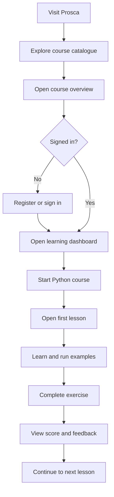
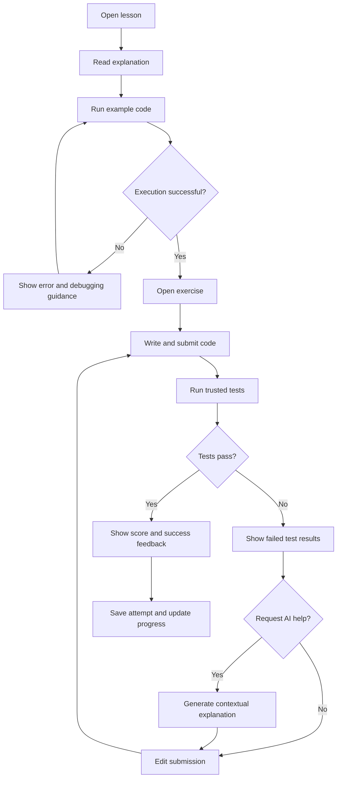
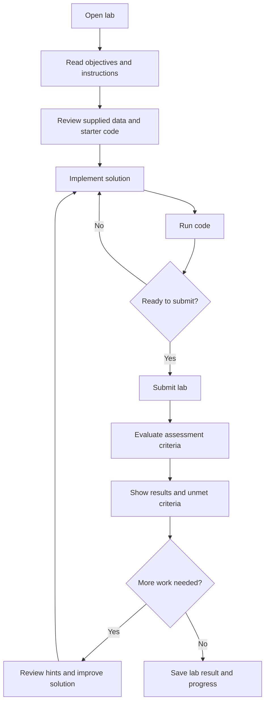
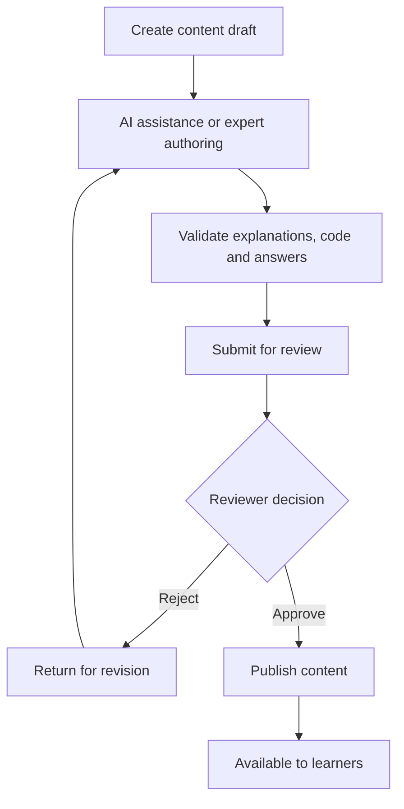

# Spascle — Information Architecture & User Flows

**Version 1.0 · MVP · October 2026**

The goal is to define **how Spascle is organized, how users navigate it, and how the application changes state as they learn, submit work, and review content**. This is independent of the database schema and final visual design.

---

## 1. Site Map

### Public Area
- Home
- About Spascle
- Course Catalogue
- Course Overview
- Sign In / Register

### Learning Area
- Dashboard
- My Learning
- Course Overview
- Lesson Viewer
- Exercise Workspace
- Lab Workspace
- Progress and History
- Account Settings

### Content Management
- Content Overview
- Draft Editor
- Review Queue
- Preview and Validation
- Publish / Reject

### Administration
- User and Role Management
- Content Access
- Basic Operational Status

**Navigation rules:**
- **Learn** — discover courses and continue learning.
- **My Learning** — access started courses and track progress.
- **Dashboard** — resume recent activity and find the next recommended step.
- **Account Menu** — profile, settings and sign out.

Reviewer and administrator links appear only for authorized users.

---

## 2. Core Learning Hierarchy

**Course: Python for Computational Materials Science**

↓ **Module**

↓ **Lesson**

↓ Learning activities:
- Explanation and examples
- Exercises
- Guided labs

The course introduces concepts progressively. Scientific packages such as NumPy and Matplotlib appear in relevant lessons rather than as disconnected courses in the initial experience.

Bash can later appear as another course within the same learning hierarchy.

---

## 3. User Flow Diagrams

### Flow A — New Learner

**Key behavior:** The course catalogue and course overview can be explored publicly. Starting learning requires an authenticated account so progress can be saved.

### Flow B — Lesson, Exercise and AI Feedback

**Important distinction:** AI feedback is optional support. The assessment result comes from trusted grading rules, and the learner can retry without requesting AI assistance.

### Flow C — Guided Lab

The initial labs use lightweight datasets and calculations. Heavy DFT and HPC workloads are outside the MVP.

### Flow D — Content Creation and Publishing

AI-generated content must not go directly to published status. Reviewers must be able to inspect learning materials, exercises, expected answers and assessment criteria.

---

## 4. State Transitions

### 4.1 Content Lifecycle

**Draft → In Review → Approved → Published**

If rejected, content returns for revision.

Only published content is available to learners. Changes to published content should create a revision that can be reviewed before replacing the live version.

### 4.2 Exercise Attempt Lifecycle

**Not Started → In Progress → Submitted → Graded**

After grading, the learner can start another attempt. Each attempt retains its own result.

If execution fails due to a platform error, the learner receives a clear error and is not incorrectly penalized for a system failure.

### 4.3 Lesson Progress

A lesson has three learner-facing states:

- **Not Started**
- **In Progress**
- **Completed**

Opening a lesson alone does not necessarily mark it complete. Completion follows the course's defined rule, such as finishing the required activity or explicitly marking a lesson complete where no assessment is required.

### 4.4 Execution Lifecycle

**Queued → Running → Completed / Failed / Timed Out / Cancelled**

The interface displays the current status while a run is processing. Temporary execution environments are cleaned up after completion or termination.

---

## 5. Navigation and Interaction Rules

- Learners should always have a clear way back to the course or current module.
- Lessons should provide previous/next navigation where a meaningful sequence exists.
- Exercise and lab results should offer a clear retry or continue action.
- The dashboard should prioritize **Continue Learning**, rather than a complicated analytics dashboard.
- Errors should be actionable and distinguish learner code errors from platform failures.
- AI help should be available near the relevant error or assessment result, not hidden in a separate tool.
- Reviewers should be able to preview content as a learner would see it before publishing.
- Authentication should preserve the intended destination when a user is asked to sign in.

---

## 6. Recommended MVP Page Inventory

| Page | Access | Priority |
|---|---|---|
| Home | Public | Must |
| Course Catalogue | Public | Must |
| Course Overview | Public | Must |
| Sign In / Register | Public | Must |
| Learning Dashboard | Learner | Must |
| Lesson Viewer | Learner | Must |
| Exercise Workspace and Results | Learner | Must |
| Guided Lab Workspace and Results | Learner | Must |
| Progress and Attempt History | Learner | Must |
| Content Review and Publishing | Reviewer | Must |
| User and Role Administration | Administrator | Must |
| Account Settings | Learner | Should |
| Dedicated Analytics Dashboard | Administrator | Could |
| Standalone AI Tutor | Learner | Won't have in MVP |

---

## 7. Decisions to Carry into Wireframes

The IA is defined at the structural level. The next deliverable should be low-fidelity wireframes for these five screens:

1. **Learning Dashboard** — resume learning, course progress and recent activity.
2. **Lesson Page** — content, examples, navigation and embedded exercises.
3. **Coding Workspace** — editor, run controls, output, test results and AI help.
4. **Guided Lab Page** — objectives, supplied data, code workspace and assessment criteria.
5. **Content Review Page** — preview, validation status, review decisions and publishing.

These screens cover the most important learner and reviewer journeys without requiring every page to be designed independently.
