# SPASCLE — Information Architecture & User Flows

Version: 2.0\
Scope: MVP / Release 1\
Date: November 2026\
Status: Revised draft

This document defines the information architecture (IA) for the SPASCLE MVP. It translates the revised PRD and SRS into a practical structure for organizing the platform's pages, navigation, content, and interactive learning experiences.

The IA focuses exclusively on the MVP. Authentication, learner profiles, persistent progress, administrator interfaces, reviewer interfaces, and Bash are excluded from the MVP architecture.

# 1. Purpose

The purpose of this document is to define:

- The overall structure of the SPASCLE platform.
- The relationship between its major pages and features.
- The navigation hierarchy for the Python learning area.
- The organization of lessons, exercises, and guided labs.
- The placement of scientific-context controls.
- The interaction between the lesson interface, code editor, execution environment, assessment system, and AI assistance.
- The principal user journeys through the MVP.

The architecture should support a straightforward learning experience for beginners while allowing the platform to accommodate additional courses, scientific contexts, and programming languages in future releases.

# 2. IA Design Principles

The information architecture shall follow these principles.

| Principle                   | Application                                                                                           |
| --------------------------- | ----------------------------------------------------------------------------------------------------- |
| Public-first access         | Visitors should be able to start learning without registration or sign-in.                            |
| Learning-focused navigation | The course structure should make it easy to move between modules and lessons.                         |
| Progressive learning        | Content should move from introductory concepts towards more advanced applications.                    |
| Scientific relevance        | Materials science should be the default context for examples and exercises.                           |
| Context flexibility         | Learners should be able to select another scientific context globally or within an individual lesson. |
| Integrated practice         | Coding, execution, exercises, and feedback should be accessible within the learning experience.       |
| Clear separation of content | Explanations, examples, exercises, and guided labs should be distinguishable.                         |
| Extensibility               | The architecture should accommodate additional contexts, courses, and programming languages later.    |
| Minimal complexity          | The MVP should avoid unnecessary dashboards, account systems, and administrative interfaces.          |

# 3. Overall Information Architecture

The MVP consists of two primary areas:

1. Public landing page: Introduces SPASCLE and directs visitors to the learning environment.
2. Python learning area: Contains the course structure, lessons, coding environment, exercises, assessments, and guided labs.

The coding environment and assessment features are integrated into the learning experience rather than treated as independent products.

## 3.1 High-level site map

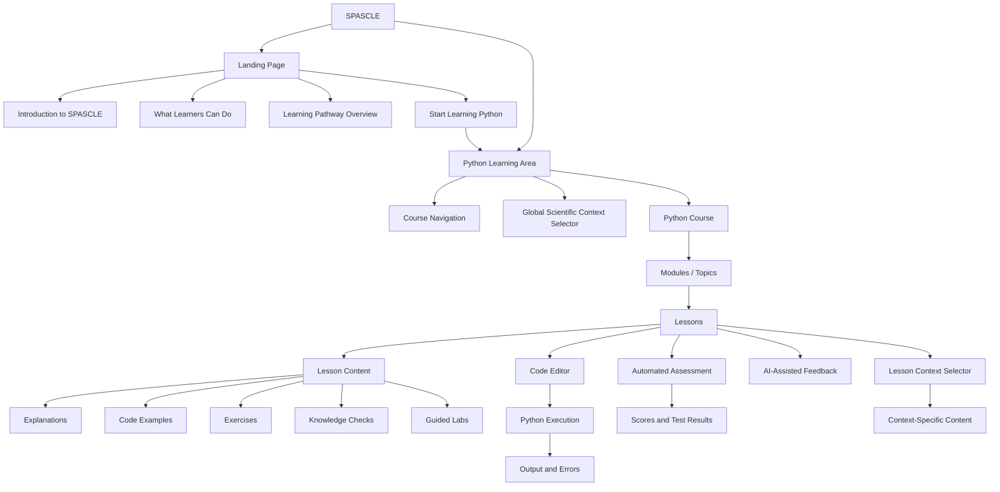

## 3.2 Primary navigation structure

The MVP should have a simple navigation structure.

| Navigation area             | Purpose                                                            |
| --------------------------- | ------------------------------------------------------------------ |
| SPASCLE logo                | Returns the visitor to the landing page.                           |
| Home                        | Opens the public landing page.                                     |
| Learn Python                | Opens the Python learning area.                                    |
| Scientific context selector | Changes the preferred scientific context across the learning area. |
| Course sidebar              | Provides navigation between modules and lessons.                   |

The learning area should prioritize course navigation rather than general website navigation.

No account menu, profile avatar, sign-in button, or learner dashboard is required in the MVP.

# 4. Page and Screen Architecture

## 4.1 Landing Page

Purpose: Introduce the platform and encourage visitors to begin learning.

### Main sections

| Section                  | Content                                                               | Primary action            |
| ------------------------ | --------------------------------------------------------------------- | ------------------------- |
| Hero section             | Platform introduction, value proposition, and Python learning pathway | Start learning            |
| About SPASCLE            | Explanation of the platform and its purpose                           | Learn more                |
| Learning approach        | Lessons, scientific examples, coding exercises, and guided labs       | Explore learning approach |
| Scientific applications  | Introduction to scientific programming and its applications           | Explore Python pathway    |
| Learning pathway preview | Overview of the initial Python course                                 | Start Python              |
| Footer                   | Relevant platform information and links                               | Navigation                |

### Landing page hierarchy

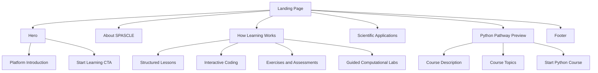

### Landing page behavior

- The primary call-to-action shall take visitors directly to the Python learning area.
- Visitors shall not be required to register or sign in.
- The landing page shall communicate that the platform is initially focused on Python for scientific programming.
- The landing page shall not imply that other programming pathways are already available.

## 4.2 Python Learning Area

Purpose: Provide the main learning interface through which visitors access lessons, write code, complete exercises, and participate in guided labs.

### Main layout

The learning area should follow a documentation-style interface inspired by platforms such as W3Schools.


The layout consists of three primary regions:

| Region            | Responsibility                                                           |
| ----------------- | ------------------------------------------------------------------------ |
| Left sidebar      | Displays course, modules, and lesson navigation.                         |
| Main content area | Displays the selected lesson, explanations, examples, and activities.    |
| Context controls  | Provides global scientific-context selection and lesson-level overrides. |

The code editor and execution output may appear within lesson activities or in a dedicated expandable workspace, depending on the lesson design.

### Suggested layout

```
+--------------------------------------------------------------+
| SPASCLE             Python Learning       Scientific Context |
+--------------------+-----------------------------------------+
|                    |                                         |
| COURSE SIDEBAR     |         LESSON CONTENT                  |
|                    |                                         |
| Python             |  Lesson title                           |
|                    |  Learning objectives                    |
| Module 1           |                                         |
|  - Lesson 1        |  Explanation                            |
|  - Lesson 2        |                                         |
|  - Lesson 3        |  Code example                           |
|                    |                                         |
| Module 2           |  Interactive exercise                   |
|  - Lesson 4        |                                         |
|  - Lesson 5        |  Code editor                            |
|                    |  Run code                               |
|                    |  Output / errors                        |
|                    |                                         |
|                    |  Assessment and feedback                |
|                    |                                         |
|                    |  Previous lesson       Next lesson      |
|                    |                                         |
+--------------------+-----------------------------------------+
```

This is a logical layout rather than a final visual design. Responsive behavior may rearrange the regions on smaller screens.

## 4.3 Course Sidebar

Purpose: Help learners understand the course structure and move between lessons.

### Hierarchy

```
Python for Scientific Computing
│
├── Module 1: Introduction to Python
│   ├── Lesson 1: Introduction to Programming
│   ├── Lesson 2: Setting Up Your Python Environment
│   └── Lesson 3: Your First Python Program
│
├── Module 2: Python Fundamentals
│   ├── Lesson 1: Variables and Data Types
│   ├── Lesson 2: Operators and Expressions
│   ├── Lesson 3: Strings
│   └── Lesson 4: Input and Output
│
├── Module 3: Data Structures
│   ├── Lesson 1: Lists
│   ├── Lesson 2: Tuples
│   ├── Lesson 3: Dictionaries
│   └── Lesson 4: Sets
│
├── Module 4: Control Flow
│   ├── Lesson 1: Conditional Statements
│   ├── Lesson 2: For Loops
│   └── Lesson 3: While Loops
│
├── Module 5: Functions
│   ├── Lesson 1: Introduction to Functions
│   ├── Lesson 2: Function Arguments
│   └── Lesson 3: Return Values
│
├── Module 6: Scientific Python
│   ├── Lesson 1: Introduction to NumPy
│   ├── Lesson 2: NumPy Arrays
│   ├── Lesson 3: Array Operations
│   └── Lesson 4: Introduction to Matplotlib
│
└── Module 7: Computational Materials Science
    ├── Lesson 1: Representing Materials Data
    ├── Lesson 2: Working with Scientific Data
    └── Lesson 3: Visualizing Materials Properties
```

Illustrative course structure. The final module and lesson list should be confirmed during curriculum development.

### Sidebar behavior

- Modules shall be expandable and collapsible.
- Selecting a lesson shall load the corresponding lesson content.
- The currently selected lesson shall be visually highlighted.
- The sidebar shall remain accessible while navigating between lessons on larger screens.
- On smaller screens, the sidebar may be presented as a drawer or collapsible navigation panel.
- Completion indicators are not required in the MVP because persistent learner progress is deferred to Release 2.

## 4.4 Lesson Page

Purpose: Present instructional content and provide opportunities to apply the concepts being taught.

### Lesson structure

A standard lesson should follow this logical structure:

```
Lesson
│
├── Lesson Header
│   ├── Lesson Title
│   ├── Short Description
│   └── Learning Objectives
│
├── Context Controls
│   └── Lesson-Level Scientific Context Selector
│
├── Instructional Content
│   ├── Concept Explanation
│   ├── Supporting Examples
│   └── Code Examples
│
├── Practice
│   ├── Conceptual Questions
│   ├── Coding Exercises
│   └── Knowledge Checks
│
├── Interactive Coding
│   ├── Code Editor
│   ├── Run Button
│   ├── Execution Output
│   └── Error Information
│
├── Assessment
│   ├── Submission
│   ├── Test Results
│   ├── Score
│   └── Feedback
│
├── AI Assistance
│   ├── Hints
│   ├── Error Explanations
│   └── Contextual Guidance
│
└── Lesson Navigation
    ├── Previous Lesson
    └── Next Lesson
```

Not every lesson needs to contain every section. For example, an introductory conceptual lesson may contain a knowledge check but no substantial coding exercise.

### Lesson content components

| Component           | Description                                                  |
| ------------------- | ------------------------------------------------------------ |
| Lesson header       | Identifies the lesson and its purpose.                       |
| Learning objectives | States what the learner should understand or be able to do.  |
| Explanatory content | Introduces the programming concept.                          |
| Code example        | Demonstrates the concept using Python.                       |
| Scientific example  | Connects the concept to an available scientific application. |
| Exercise            | Allows the learner to apply the concept.                     |
| Knowledge check     | Tests conceptual understanding.                              |
| Code editor         | Allows code entry and execution.                             |
| Assessment result   | Displays the outcome of a submitted exercise.                |
| AI feedback         | Provides contextual hints and explanations.                  |
| Lesson navigation   | Allows movement to other lessons.                            |

# 5. Scientific Context Architecture

Scientific-context selection is a core feature of the learning experience.

The architecture must support both a global preference and a lesson-level override without confusing the learner.

## 5.1 Global context selector

The global selector establishes the preferred scientific context across the learning area.

Initial default: Materials science.

Potential context options include:

- Materials science.
- Chemistry.
- Physics.
- Biology.
- Biochemistry.
- General programming.

Only contexts with suitable prepared content should be presented as available choices for a particular lesson or activity.

## 5.2 Lesson-level context selector

The lesson-level selector allows learners to use an alternative context within an individual lesson.

For example:

- Global context: Materials science.
- Current lesson: Variables and data types.
- Lesson-level selection: Chemistry.
- Result: The current lesson displays the available chemistry example.
- The global preference remains Materials science.

## 5.3 Context selection flow

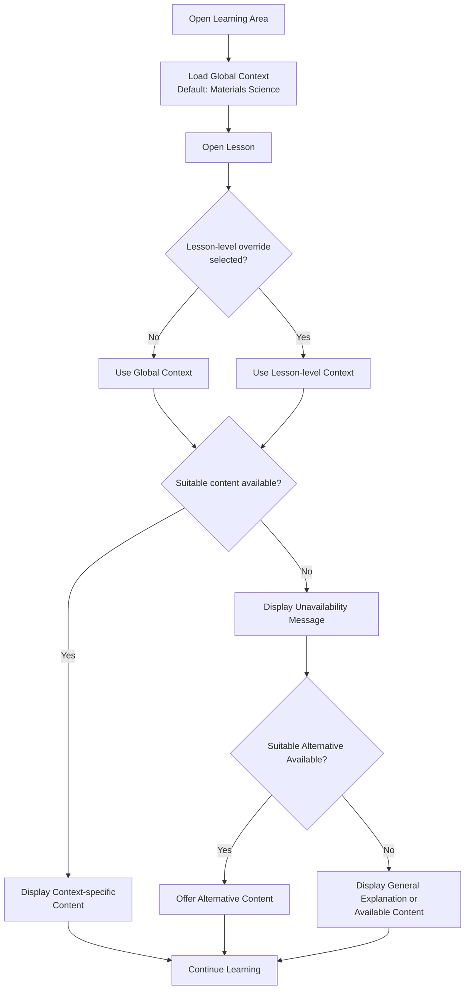

## 5.4 Context precedence rules

| Situation                                | Expected behavior                                                                              |
| ---------------------------------------- | ---------------------------------------------------------------------------------------------- |
| No context has been selected             | Materials science is used.                                                                     |
| Learner changes global context           | The new preference applies across lessons where suitable content exists.                       |
| Learner changes context within a lesson  | The lesson-level context overrides the global context for that lesson.                         |
| Learner moves to another lesson          | The new lesson uses the global preference unless a separate lesson-level override is selected. |
| Selected context has no suitable content | The system explains the limitation and offers an appropriate alternative where available.      |

# 6. Interactive Coding Architecture

The coding environment is integrated into lessons, exercises, and guided labs.

It should not feel like a separate development tool that learners must navigate away from the lesson to use.

## 6.1 Code editor structure

The coding interface should contain:

| Component        | Function                                             |
| ---------------- | ---------------------------------------------------- |
| Code editor      | Accepts and displays learner-written Python code.    |
| Run button       | Submits code for execution.                          |
| Reset control    | Restores the original starter code where applicable. |
| Output panel     | Displays successful execution output.                |
| Error panel      | Displays execution errors.                           |
| Copy control     | Copies learner code.                                 |
| Download control | Downloads code where supported.                      |
| AI assistance    | Provides hints or explanations where available.      |

## 6.2 Execution interaction flow

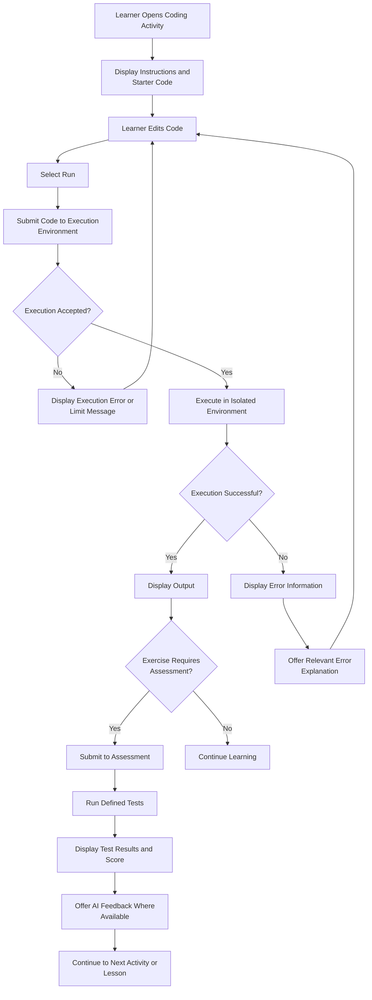

## 6.3 Execution and assessment separation

The architecture should distinguish between code execution and exercise assessment.

Code execution answers:

- Does the code run?
- What output does it produce?
- Did it produce an error?

Exercise assessment answers:

- Does the submission satisfy the exercise requirements?
- Which tests passed or failed?
- What score or result should be returned?

A program can execute successfully and still fail an exercise because its output or behavior does not meet the expected criteria.

## 6.4 Supported execution environment

The initial execution environment shall support:

- Python standard library.
- NumPy.
- Matplotlib.
- Other packages explicitly approved for the MVP.

The interface should not expose arbitrary package installation, unrestricted network access, or unrestricted filesystem access.

# 7. Exercise and Assessment Architecture

Exercises should be presented within the lesson where the relevant concept is taught.

## 7.1 Exercise hierarchy

```
Lesson
│
├── Exercise
│   ├── Exercise Title
│   ├── Instructions
│   ├── Learning Objective
│   ├── Exercise Type
│   ├── Starter Code (where applicable)
│   ├── Submission Interface
│   ├── Assessment Criteria
│   └── Feedback
│
└── Assessment Result
    ├── Pass / Fail or Result Status
    ├── Score (where applicable)
    ├── Test Outcomes
    └── Feedback
```

## 7.2 Exercise types

| Exercise type               | Learner interaction                       | Assessment approach            |
| --------------------------- | ----------------------------------------- | ------------------------------ |
| Multiple choice             | Selects an answer                         | Predefined correct answer      |
| Conceptual question         | Responds to a question                    | Defined answer criteria        |
| Knowledge check             | Answers a short question                  | Defined answer criteria        |
| Coding exercise             | Writes and submits Python code            | Automated test cases           |
| Scientific programming task | Uses Python to solve a scientific problem | Defined computational criteria |

## 7.3 Assessment flow

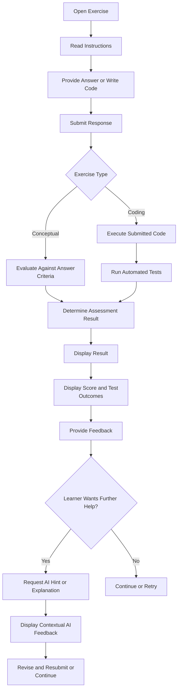

# 8. AI-Assisted Learning Architecture

AI assistance should be integrated into relevant learning activities.

It should not replace the instructional structure or become a mandatory step in every lesson.

## 8.1 AI assistance entry points

| Entry point         | Purpose                                                          |
| ------------------- | ---------------------------------------------------------------- |
| Exercise hint       | Provides a clue when a learner is struggling.                    |
| Error explanation   | Explains a programming error in beginner-friendly language.      |
| Assessment feedback | Helps explain why a submission did not satisfy the requirements. |
| Concept explanation | Clarifies a concept related to the current lesson.               |
| Lab guidance        | Provides assistance with a specific step in a guided lab.        |

## 8.2 AI interaction flow

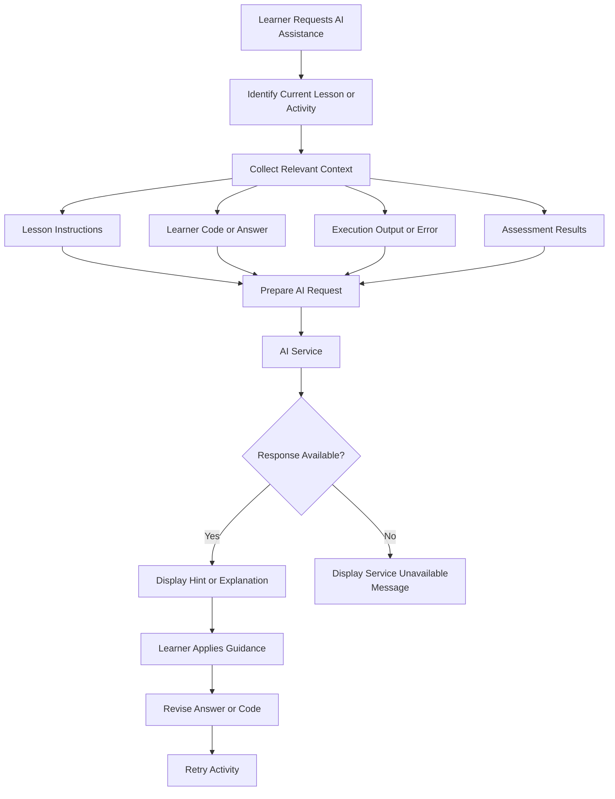

## 8.3 AI interaction rules

- AI assistance shall be contextual to the current lesson or activity.
- The system should avoid sending unnecessary information to the AI service.
- AI feedback should be distinguishable from automated assessment results.
- AI assistance should be optional.
- Failure of AI services should not prevent learners from continuing with available lesson content.

# 9. Guided Computational Lab Architecture

Guided labs provide a more complete practical learning experience than individual coding exercises.

They should guide learners through a scientific problem using Python.

## 9.1 Guided lab structure

```
Guided Lab
│
├── Lab Overview
│   ├── Title
│   ├── Description
│   └── Learning Objectives
│
├── Scientific Problem
│   ├── Background
│   └── Problem Statement
│
├── Lab Instructions
│   ├── Step 1
│   ├── Step 2
│   ├── Step 3
│   └── Additional Steps
│
├── Computational Workspace
│   ├── Starter Code
│   ├── Input Data
│   ├── Code Editor
│   ├── Execution
│   └── Output
│
├── Assessment
│   ├── Defined Criteria
│   ├── Test Results
│   └── Feedback
│
└── Completion
    └── Summary and Next Activity
```

## 9.2 Guided lab flow

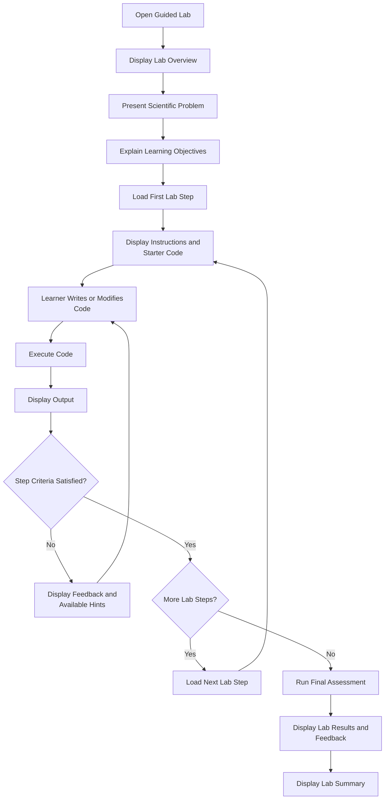

## 9.3 Lab navigation

A guided lab should provide:

- Clear identification of the current step.
- Instructions that remain accessible while coding.
- Access to starter code and input data.
- A way to execute and inspect code output.
- Relevant feedback when a step is unsuccessful.
- A clear transition between steps.

The MVP does not require permanent storage of completed lab progress against a learner account.

# 10. Content Architecture

The content architecture defines how instructional materials are organized and related.

## 10.1 Content hierarchy

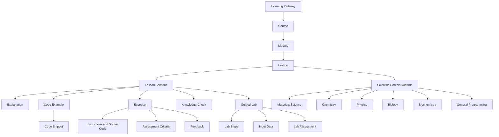

## 10.2 Content organization rules

1. Every lesson shall belong to a module.
2. Every module shall belong to a course.
3. Lessons shall contain one or more instructional sections.
4. Exercises shall be associated with relevant lessons.
5. Coding exercises shall have appropriate assessment criteria.
6. Guided labs shall contain structured steps and relevant computational materials.
7. Context-specific content shall be associated with the appropriate scientific context.
8. A lesson does not need to support every available scientific context.
9. Published materials shall pass human review and approval.
10. Content shall be organized so additional modules and learning pathways can be introduced without redesigning the existing hierarchy.

# 11. MVP User Flows

This section defines the major user journeys through the platform.

## 11.1 Visitor starts learning

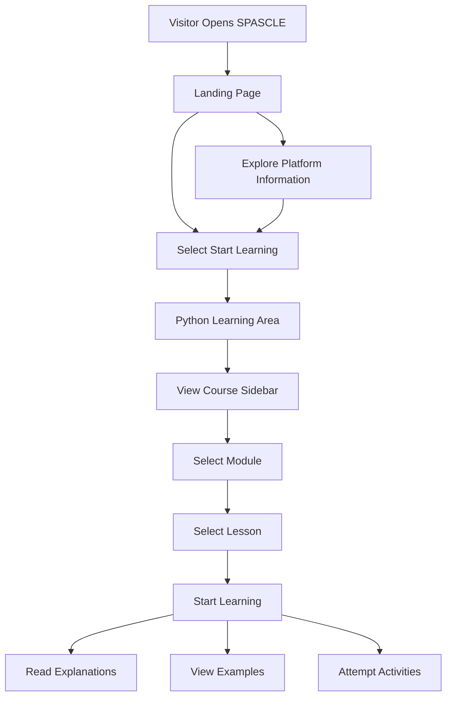

## 11.2 Learner completes a coding exercise

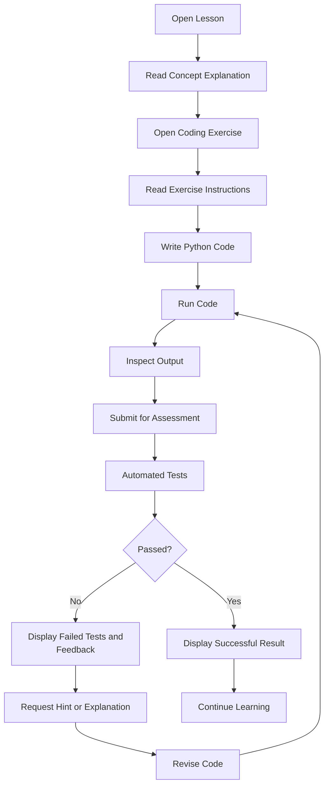

## 11.3 Learner switches scientific context

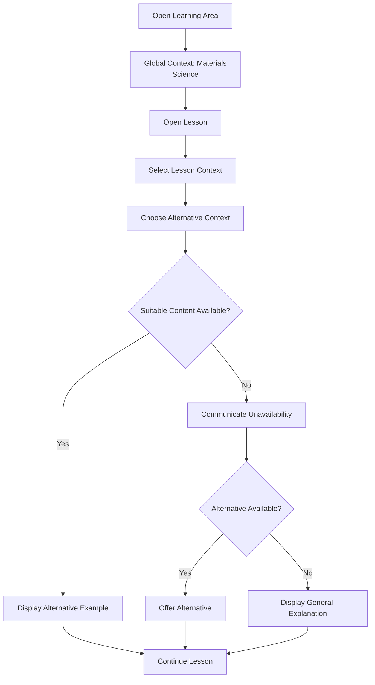

## 11.4 Learner completes a guided lab

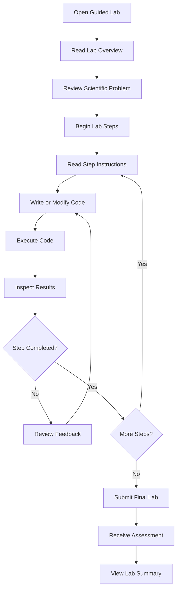

# 12. Navigation and Interaction Rules

The following rules define how the main parts of the interface should behave.

| Area              | Rule                                                                                 |
| ----------------- | ------------------------------------------------------------------------------------ |
| Landing page      | The primary learning action opens the Python learning area.                          |
| Course sidebar    | Selecting a lesson loads its content in the main area.                               |
| Module navigation | Modules can be expanded and collapsed.                                               |
| Active lesson     | The current lesson is visually identified.                                           |
| Global context    | The selected context applies across lessons where suitable content exists.           |
| Lesson context    | Overrides the global context for the current lesson only.                            |
| Code editor       | Learners can edit and execute code without leaving the lesson.                       |
| Execution output  | Results and errors appear in a clearly identifiable output area.                     |
| Assessment        | Learners receive assessment results after submitting supported activities.           |
| AI assistance     | Hints and explanations are accessible from relevant activities.                      |
| Guided labs       | Lab instructions and computational workspace are accessible throughout the activity. |
| Lesson navigation | Previous and next lesson controls support sequential learning.                       |
| Progress          | No persistent account-based completion indicators are displayed in the MVP.          |

# 13. Responsive Information Architecture

The information architecture should adapt to smaller screens without removing essential learning capabilities.

| Interface area          | Desktop                     | Tablet                    | Mobile                    |
| ----------------------- | --------------------------- | ------------------------- | ------------------------- |
| Course sidebar          | Persistent left sidebar     | Collapsible sidebar       | Drawer or expandable menu |
| Lesson content          | Central reading area        | Main content area         | Full-width content        |
| Global context selector | Header control              | Header or compact control | Compact selector          |
| Code editor             | Integrated lesson workspace | Responsive workspace      | Full-width editor         |
| Output panel            | Beside or below editor      | Below editor              | Below editor              |
| AI feedback             | Inline or side panel        | Inline panel              | Expandable panel          |
| Lesson navigation       | Previous/next controls      | Previous/next controls    | Stacked controls          |

### Mobile-specific considerations

- Course navigation should be accessible without occupying the entire screen permanently.
- Code editor controls should remain usable on smaller displays.
- Output and error panels should be easy to expand and inspect.
- Lesson explanations should remain readable while the learner interacts with coding activities.
- Context selection should remain visible and accessible.

# 14. MVP Screen Inventory

The following inventory identifies the main screens and interface states required for implementation.

| ID      | Screen / View                      | Description                                             | Priority  |
| ------- | ---------------------------------- | ------------------------------------------------------- | --------- |
| SCR-001 | Landing page                       | Public platform introduction                            | Must have |
| SCR-002 | Python learning home               | Entry point to the Python pathway                       | Must have |
| SCR-003 | Course navigation                  | Module and lesson sidebar                               | Must have |
| SCR-004 | Lesson view                        | Main instructional content                              | Must have |
| SCR-005 | Global context selector            | Scientific context preference                           | Must have |
| SCR-006 | Lesson context selector            | Lesson-level context override                           | Must have |
| SCR-007 | Context unavailable state          | Explains unavailable context content                    | Must have |
| SCR-008 | Code editor                        | Python code entry and editing                           | Must have |
| SCR-009 | Execution output                   | Displays output and errors                              | Must have |
| SCR-010 | Exercise view                      | Displays exercise instructions and submission interface | Must have |
| SCR-011 | Assessment result                  | Displays score, test outcomes, and feedback             | Must have |
| SCR-012 | AI assistance panel                | Displays hints and explanations                         | Must have |
| SCR-013 | Guided lab overview                | Introduces a computational lab                          | Must have |
| SCR-014 | Guided lab workspace               | Instructions, code editor, and output                   | Must have |
| SCR-015 | Guided lab result                  | Displays final assessment and summary                   | Must have |
| SCR-016 | Code execution error state         | Displays execution failures and limits                  | Must have |
| SCR-017 | AI service unavailable state       | Communicates AI service failure                         | Must have |
| SCR-018 | Empty or unavailable content state | Handles unavailable lessons or activities               | Must have |

# 15. MVP Exclusions

The following screens and workflows are intentionally excluded from the MVP information architecture.

| Excluded area                  | Reason                                                              |
| ------------------------------ | ------------------------------------------------------------------- |
| Registration page              | Authentication is deferred to Release 2.                            |
| Sign-in page                   | Authentication is deferred to Release 2.                            |
| Learner profile                | User profiles are deferred to Release 2.                            |
| Learner dashboard              | Persistent account-based progress is deferred.                      |
| Course completion dashboard    | Course completion percentage is a Release 2 feature.                |
| Completed lesson indicators    | Account-linked completion indicators are deferred.                  |
| Administrator dashboard        | Administrator functionality is deferred to Release 2.               |
| Content management interface   | Managed through the internal content-production process in the MVP. |
| Reviewer dashboard             | Reviewer accounts and interfaces are deferred to Release 2.         |
| Bash learning area             | Planned for a later release.                                        |
| Classroom dashboard            | Managed classes are outside the current scope.                      |
| Subscription and payment pages | Payment functionality is outside the current scope.                 |

# 16. Future Extensibility Considerations

Although the IA is limited to the MVP, it should not prevent the introduction of later capabilities.

The following structural considerations should be maintained:

1. Additional learning pathways: The top-level course structure should support multiple courses rather than being hard-coded exclusively for Python.
2. Additional scientific contexts: Context variants should be associated with lessons or content sections, allowing different lessons to support different contexts.
3. Additional programming languages: The learning area should be extensible to other language-specific learning pathways.
4. Authentication: Account-related navigation can be introduced without restructuring the public learning hierarchy.
5. Persistent progress: Lesson and course completion indicators can be added to the sidebar in Release 2.
6. Content administration: A future administration interface should manage the same course and content hierarchy used by the learner-facing application.
7. Content review: Reviewer workflows should operate on the same underlying content entities and permissions model as administrator workflows.

These considerations should guide the technical design without introducing deferred features into the MVP interface.

# 17. MVP IA Completion Criteria

The information architecture shall be considered sufficiently defined for MVP design and implementation when:

- The landing page and Python learning area are clearly separated.
- The course, module, and lesson hierarchy is defined.
- The sidebar and central lesson layout are specified.
- The standard lesson structure is defined.
- Global and lesson-level context selection behavior is documented.
- Code editor and execution interfaces are identified.
- Exercise and assessment interfaces are identified.
- AI assistance entry points are defined.
- Guided lab structure and navigation are defined.
- Main learner journeys are documented using flow diagrams.
- Desktop, tablet, and mobile navigation behavior is considered.
- MVP exclusions are clearly identified.
- Future extensibility is considered without expanding MVP scope.

# 18. Relationship to Other Project Documents

| Document                              | Responsibility                                                                 |
| ------------------------------------- | ------------------------------------------------------------------------------ |
| PRD                                   | Defines product vision, objectives, users, features, and release scope.        |
| SRS                                   | Defines functional and non-functional system requirements.                     |
| Information Architecture & User Flows | Defines pages, navigation, content hierarchy, and user journeys.               |
| Data Model & Database Design          | Defines data entities, attributes, and relationships.                          |
| API Contracts & Interface Design      | Defines communication between application components and services.             |
| Technical Architecture                | Defines technology choices, system components, infrastructure, and deployment. |
| UI/UX Design Specification            | Defines detailed visual design, component behavior, and screen layouts.        |

> **One important implementation distinction:** The IA treats the code editor, execution output, assessment, and AI feedback as integrated parts of lessons and labs. They are separate functional components, but learners should experience them as one continuous learning workflow. This avoids making the MVP feel like a collection of disconnected tools.
