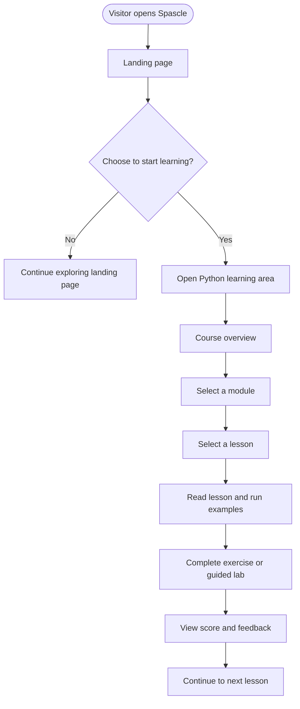
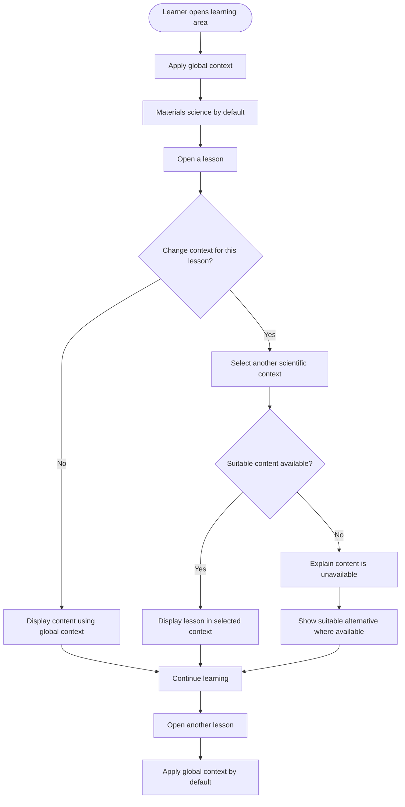
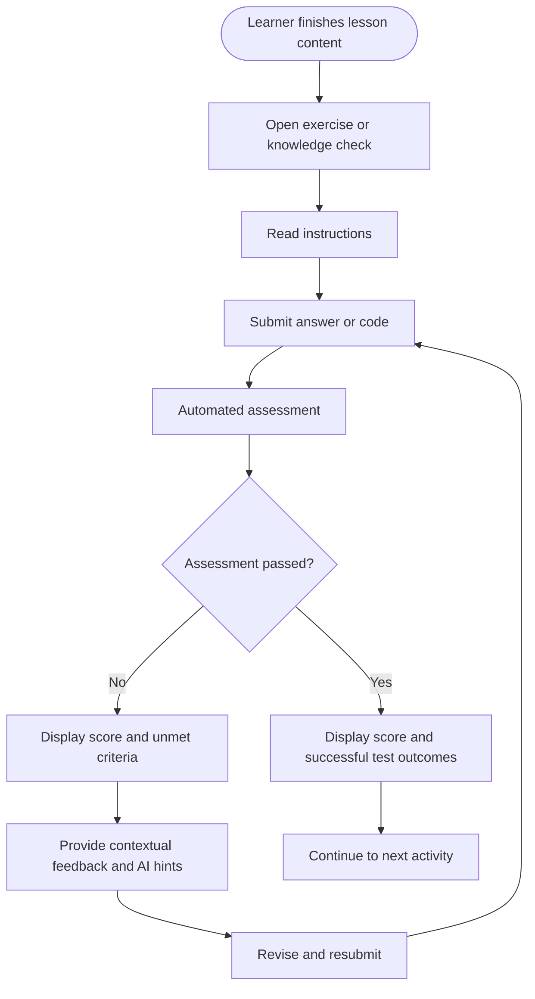
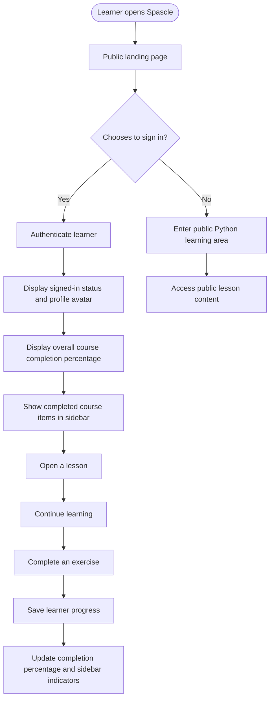
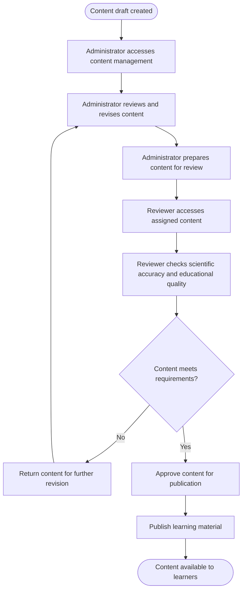

# Spascle — Product Requirements Document (PRD)

**Version 1.1 · MVP · November 2026**

---

## 1. Context and objectives

### 1.1 Product vision

Spascle is an AI-powered online learning platform that helps beginners learn programming through practical, field-specific scientific applications.

Rather than teaching programming in isolation, Spascle connects programming concepts to problems learners recognize from their scientific disciplines.

The initial focus is computational materials science, with plans to expand into other scientific fields and programming languages over time.

### 1.2 Problem

Chemistry, materials science and other science students may need programming skills for research but struggle to find learning resources that connect programming concepts to their academic backgrounds.

General programming platforms often lack relevant scientific examples, while specialized computational science resources can assume prior programming knowledge.

Spascle aims to bridge this gap through structured explanations, practical exercises, interactive coding environments and guided scientific projects.

### 1.3 Value proposition

Spascle will enable learners to:

- Learn programming from the beginning using familiar scientific contexts.
- Practice code directly in the browser without configuring a local development environment.
- Apply programming concepts to computational materials science problems.
- Receive immediate assessment results, hints and contextual explanations.
- Progress through structured, expert-reviewed learning materials at their own pace.
- Explore programming concepts through examples from different scientific disciplines.

AI will accelerate content development and provide learning support, while human review and reliable assessment methods maintain educational quality.

### 1.4 Product objectives

1. Launch a useful, beginner-friendly Python learning experience for computational materials science.
2. Make scientific programming practice accessible through a browser.
3. Provide reliable automated grading and contextual AI feedback.
4. Establish a repeatable process for creating, reviewing and publishing learning materials.
5. Validate learner engagement and learning outcomes before expanding the platform.

### 1.5 Success metrics

Initial targets for the limited pilot are:

| Metric | Target |
| --- | ---: |
| Published lessons approved before release | 100% |
| Valid supported sample programs executing successfully | ≥95% |
| Onboarded learners starting their first lesson | ≥60% |
| First-lesson starters completing an exercise | ≥50% |
| Learners returning within seven days | ≥20% |

These are initial validation targets, not established benchmarks. Results should guide subsequent product decisions.

---

## 2. User and market profiling

### 2.1 Target audience

The initial audience is university students, recent graduates and self-directed learners interested in computational materials science who have little or no programming experience.

| Persona | Needs and goals |
| --- | --- |
| Beginner science student | Learn Python from scratch through examples relevant to materials science. |
| Aspiring computational researcher | Practice scientific data manipulation, calculations and visualization in a practical environment. |
| Independent learner | Study at their own pace and receive useful feedback without an instructor. |
| Content reviewer | Ensure lessons, exercises, code examples and answer keys are scientifically and educationally correct. |
| Platform administrator | Manage course content, reviewer access and the quality of the learning experience. |

### 2.2 User scenarios

**Scenario A — Learning Python**

A materials science student with no programming experience opens Spascle and enters the Python learning area without registering. The student starts the Python course, reads a beginner-friendly lesson, runs the example code and completes a short exercise. The student receives a score and feedback explaining any mistakes.

**Scenario B — Switching scientific contexts**

A learner studying a Python concept through a materials science example switches the lesson's scientific context to chemistry or physics. The example and exercise change to reflect the selected field where suitable content is available. The learner can also change the general scientific context, which becomes the default across the learning pages.

**Scenario C — Applying scientific packages**

A learner reaches a lesson on scientific computing and uses NumPy to manipulate numerical data or Matplotlib to visualize a scientific dataset. The learner practices in the browser without having to install these packages locally.

**Scenario D — Completing a guided lab**

A learner works through a computational materials science problem using supplied data and starter code. Spascle evaluates the submission against defined criteria and provides feedback on what worked and what needs improvement.

**Scenario E — Returning to learning**

A learner opens Spascle and continues directly to the public learning content without signing in. In a later release, an authenticated learner will be able to sign in and see their overall course completion percentage, account status and profile avatar. Completed course items will also be visually marked in the course navigation sidebar, allowing the learner to identify completed lessons and continue from where they left off.

**Scenario F — Preparing and revising learning materials**

An administrator manages course content and can revise existing materials. In the subsequent reviewer stage, reviewers can also revise course content, check AI-generated drafts, verify scientific explanations and code, check exercises and answer keys, and help ensure that published materials meet the required standards.

---

## 3. Functional requirements and feature scope

The MVP will use the MoSCoW prioritization method: Must have, Should have, Could have and Won't have.

### 3.1 Must have — MVP essentials

**A. Landing page and learning area**

- A public landing page introducing Spascle, its purpose and the learning opportunities available.
- A publicly accessible Python learning area.
- No registration or sign-in requirement to access learning content.
- A structured Python course focused initially on computational materials science.
- Organized modules and lessons with explanations, examples and exercises.
- A clear course navigation sidebar for moving between modules and lessons.
- A learning-page layout inspired by W3Schools, with course navigation alongside a central lesson content area.
- Materials science as the default scientific context for examples and exercises.
- The ability to switch the scientific context within an individual lesson, where suitable content is available.
- A general scientific-context selector that applies the selected context across the learning pages by default.
- Support for scientific contexts such as materials science, chemistry, physics, biology, biochemistry and general programming, as relevant content becomes available.
- Lesson-level context selection takes precedence over the general context selection for that lesson.
- Clear communication when a suitable example or exercise is unavailable in the selected context, with an appropriate alternative where possible.

**B. Interactive coding**

- An in-browser code editor and execution environment.
- Support for Python and approved scientific packages.
- Display of program output and understandable error messages.
- Temporary coding sessions and the ability to copy or download code where practical.

**C. Exercises and automated assessment**

- Conceptual quizzes and coding exercises.
- Automatic evaluation of coding submissions.
- Scores, test outcomes and contextual feedback.
- AI-generated hints and explanations based on the learner's work and assessment results.

**D. Guided scientific labs**

- Step-by-step practical problems based on computational materials science.
- Instructions, learning objectives, starter code or supplied datasets where appropriate.
- Defined assessment criteria and useful feedback.
- Lightweight computations suitable for an online learning environment.

**E. AI-assisted learning and content development**

- AI-generated drafts of lessons, examples, exercises, quizzes and lab instructions.
- AI assistance explaining errors and suggesting improvements.
- Human review and approval before generated content is published.
- Reliable grading based primarily on predefined tests and assessment criteria, rather than unrestricted AI judgment.

### 3.2 Should have — subsequent release (Release 2)

The following features are planned for the next release and are not part of the MVP.

**A. Authentication and learner progress**

- Learner registration and authentication.
- Sign-in and sign-out functionality.
- Display of the learner's authenticated status when signed in.
- A profile avatar for authenticated learners.
- Persistent lesson completion and assessment history.
- Display of the learner's overall course completion percentage.
- Visual completion indicators beside course items in the learning navigation sidebar, clearly identifying lessons or items the learner has completed.
- The ability to resume learning across sessions using saved progress.

**B. Content administration and review**

These capabilities will be introduced in sequence.

**1. Administrator functionality**

- Administrator accounts and restricted access to administration features.
- Ability to create, edit and revise course content.
- Ability to manage course materials and published learning content.
- Ability to manage reviewer access and relevant content workflows.

**2. Reviewer functionality**

- Reviewer accounts and restricted access to assigned review functions.
- Ability to review and revise course content.
- Ability to check scientific accuracy, educational clarity, code examples, exercises and answer keys.
- Ability to contribute to maintaining the quality of published learning materials.

Both administrators and reviewers will be able to revise course content, subject to their respective permissions.

**C. Bash learning pathway**

- A beginner Bash course introduced after the initial Python learning experience.
- Structured Bash lessons, examples and exercises.
- Appropriate coding and assessment support for the Bash learning environment.

Bash is planned for a later release after Python; it is not part of the initial MVP.

### 3.3 Could have — later enhancements

- Additional computational materials science projects.
- More personalized learning recommendations based on learner progress.
- More advanced AI-assisted evaluation of open-ended lab work.
- Additional scientific libraries and programming environments.
- Expanded learner dashboards.
- Additional programming languages and scientific learning pathways.

### 3.4 Won't have — initial MVP

- Mandatory registration or sign-in to access learning content.
- User profiles, profile avatars or authenticated status displays.
- Persistent, account-based learner progress.
- Course completion percentages or completed-lesson indicators in the sidebar.
- Administrator and reviewer accounts or their content-management interfaces.
- Payments, subscriptions or a paid course marketplace.
- Teacher accounts, classroom management or institutional dashboards.
- A standalone conversational AI tutor.
- Native mobile or desktop applications.
- Persistent, full-featured personal coding workspaces.
- Unrestricted package installation or arbitrary external network access from code.
- Heavy DFT calculations, HPC workloads or production-scale scientific simulations.
- Courses for every scientific discipline at launch.
- Bash instruction in the initial MVP.

---

## 4. Non-functional requirements and product guardrails

These requirements define the expected quality of the user experience without prescribing the underlying engineering implementation.

| Area | Requirement |
| --- | --- |
| Usability | Beginners should be able to start learning without prior programming or local environment setup. |
| Performance | Ordinary course pages should load within approximately 3 seconds under normal pilot conditions. |
| Reliability | Lessons and deterministic grading should remain usable when the AI service is unavailable. |
| Security | Learner code must execute in a restricted environment and must not access application secrets or other learners' data. |
| Privacy | Collect only necessary personal information and avoid unnecessary retention of submitted code. |
| Quality | All published lessons must receive human review before release. |
| Assessment | Scores should be consistent, explainable and based on defined criteria. |
| Cost | The platform should support low initial traffic with sensible limits on code execution and AI usage. |
| Accessibility | Core learning and coding workflows should be usable with common browsers, readable text and keyboard navigation where practical. |
| Scalability | The product should accommodate growth without requiring a complex architecture at launch. |
| Localization | English is the initial interface and course language. Internationalization can be introduced later if needed. |

---

## 5. UX and user flow expectations

### 5.1 Core learner journey

The MVP provides direct access to learning content without requiring registration or sign-in.

### 5.2 Lesson experience

A lesson should present content in a clear progression:

1. Explain the concept in beginner-friendly language.
2. Connect it to a computational materials science application by default.
3. Show a worked example.
4. Let the learner run or modify the code.
5. Provide an exercise to check understanding.
6. Show results and relevant feedback.
7. Offer a clear path to the next activity.

Where suitable alternative content exists, learners should be able to switch the lesson's scientific context. The general context selector should also allow learners to change the preferred scientific area across the learning pages. A lesson-level selection overrides the general selection only for that lesson.

The experience should avoid overwhelming beginners with advanced scientific theory or unnecessary interface complexity.

### 5.3 Scientific context selection

The global context selector establishes the learner's preferred scientific area across the learning pages. Materials science is selected by default.

A learner can also override the global selection within an individual lesson. This override applies only to that lesson and does not change the global preference.

Supported contexts may include:

- Materials science
- Chemistry
- Physics
- Biology
- Biochemistry
- General programming

The availability of a context may vary by lesson. Spascle should not present an unrelated example as though it were specific to the selected discipline.

### 5.4 Exercise and assessment experience

Learners should be able to attempt conceptual quizzes and coding exercises after studying the relevant lesson content.

Scores and feedback should help learners understand their mistakes and identify practical next steps.

### 5.5 Lab experience

A guided lab should make it clear what the learner is trying to accomplish, what data or starter code is available, what is expected from the submission and how the result will be assessed.

Feedback should identify unmet criteria and suggest a practical next step, rather than merely reporting that the submission is incorrect.

### 5.6 Authentication and learner progress — Release 2

Authentication is not required for the MVP. Learning content remains publicly accessible.

In Release 2, authenticated learners will have access to account-related progress features.

The progress percentage and sidebar completion indicators will be available to authenticated learners only. They will reflect saved lesson completion and assessment history.

### 5.7 Content administration and review — Release 2

Content administration and review will be introduced in sequence: administrator functionality first, followed by reviewer functionality.

Both administrators and reviewers can revise course content within their assigned permissions. AI-generated content must not bypass the human review process.

### 5.8 Initial interface expectations

The MVP should contain the following primary views:

| View | Description |
| --- | --- |
| Home | Product introduction and a clear route to begin learning. |
| Course overview | Course description, learning objectives and module list. |
| Lesson page | Explanations, code examples, exercises, scientific-context selection and lesson navigation. |
| Coding workspace | Code editor, run control, output and feedback. |
| Lab page | Problem instructions, working area, submission and assessment results. |

The following views and interface elements are planned for Release 2:

| View or element | Description |
| --- | --- |
| Sign-in and registration | Account creation and authentication. |
| Authenticated learner interface | Displays the learner's signed-in status and profile avatar. |
| Learner progress display | Shows the overall course completion percentage. |
| Course navigation completion indicators | Visually marks completed course items in the sidebar, similar to the W3Schools learning interface. |
| Administrator interface | Allows administrators to manage, create, edit and revise course content. |
| Reviewer interface | Allows reviewers to review and revise course content. |

These are functional layout expectations, not final visual designs or wireframes.

---

## 6. MVP release strategy

The product should be developed and validated incrementally.

| Stage | Outcome |
| --- | --- |
| 1. Foundation | Landing page, public Python learning area, course structure and safe code execution. |
| 2. Python learning experience | Beginner course, scientific packages, context-specific examples, exercises and deterministic grading. |
| 3. AI and labs | Contextual feedback, guided labs and reviewed AI-assisted content. |
| 4. Release readiness | Reliability, security, cost controls and content validation. |
| 5. Limited pilot | Small-group learner testing and measurement against success metrics. |
| 6. MVP completion | Validate the public Python learning experience before expanding to additional features and languages. |
| 7. Release 2 — Authentication | Registration, sign-in, learner identity and persistent progress tracking. |
| 8. Release 2 — Administrator functionality | Administrator accounts, permissions and course content management and revision. |
| 9. Release 2 — Reviewer functionality | Reviewer accounts, permissions, content review and revision. |
| 10. Later release — Bash | Introduce the Bash learning pathway after the Python experience is established. |

---

## 7. Assumptions and product decisions

- Spascle will initially be a self-paced learning platform for individual learners.
- The initial launch will focus on computational materials science rather than trying to serve every scientific field.
- The MVP consists of a public landing page and a public Python learning area.
- Learners do not need to register or sign in to access learning content in the MVP.
- The learning interface will draw inspiration from W3Schools, particularly its structured course navigation, central lesson presentation and sidebar organization.
- Materials science is the default scientific context for Python examples and exercises.
- Learners can select another scientific context within an individual lesson where suitable content is available.
- A general scientific-context selection applies across the learning pages by default; a lesson-level selection overrides it for that lesson.
- NumPy, Matplotlib and other selected packages will be available as part of the supported Python learning environment.
- AI will assist with content creation and feedback, but published materials require human approval.
- Automated tests and defined criteria will remain the primary basis for objective grading.
- Authentication and persistent learner progress are deferred to Release 2.
- The authenticated learner interface in Release 2 will display the learner's signed-in status, profile avatar, overall course completion percentage and completed course items in the sidebar.
- Administrator functionality will be introduced in Release 2 before reviewer functionality.
- Both administrators and reviewers will be able to revise course content, subject to their respective permissions.
- Bash is planned for a later release after the initial Python learning experience.
- The initial user base and traffic are expected to be modest, so features and operating costs should remain proportionate.
- Expansion into other fields and advanced learning features will be guided by evidence from the pilot.

**Product direction:** Spascle should first prove that beginners can learn Python, apply it to computational materials science and complete meaningful exercises and labs in a reliable browser-based environment. The public learning content should be accessible without an account. Authentication, personalized progress, administrator and reviewer capabilities will follow in Release 2, while Bash and broader learning pathways will be introduced later.

